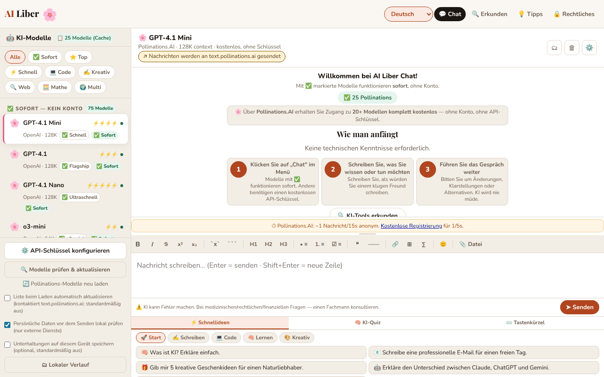

# AI Liber — Künstliche Intelligenz für alle

[English](README.md) · [Română](README.ro.md) · [Français](README.fr.md) · [Italiano](README.it.md) · [Español](README.es.md) · [Português](README.pt.md) · **Deutsch** · [Magyar](README.hu.md)

**Version:** 1.4.1 · **Zuletzt aktualisiert:** 2026-10-19

Oberflächensprachen: **Română, English, Français, Italiano, Español, Português (PT), Deutsch, Magyar**

Chatten Sie mit kostenlosen KI-Modellen oder mit Ihren eigenen API-Schlüsseln, dazu ein Leitfaden zu den besten kostenlosen KIs, in einer einzigen HTML-Datei.

**Online-Anwendung:** https://chiuta.github.io/AI-Liber/

## Was es ist

AI Liber ist eine Anwendung in einer einzigen Datei (`index.html`), die eine einheitliche Chat-Oberfläche zu mehreren Anbietern von Sprachmodellen bietet: kostenlose Dienste ohne Konto (zum Beispiel Pollinations, DuckDuckGo AI Chat, AI Horde), Dienste mit eigenem API-Schlüssel (OpenAI, Anthropic, Gemini, Groq, Mistral, OpenRouter, Perplexity), lokale Server (Ollama, LM Studio) und ein Modell, das direkt im Browser über WebLLM läuft. Sie enthält außerdem einen Bereich mit einem Katalog kostenloser KIs, ein Quiz und Prompt-Ideen.

## Funktionen

- Chat mit Modell-/Anbieterauswahl, Senden über die Schaltfläche „➤ Senden“, Abbrechen einer laufenden Anfrage.
- Markdown-Formatierungsleiste (fett, kursiv, durchgestrichen, Code, Liste, Zitat, Tabelle usw.).
- Bereich „API-Schlüssel konfigurieren“ für die Anbieter, die einen Schlüssel verlangen; die Schlüssel werden lokal gespeichert, mit AES-GCM verschleiert (die Anwendung weist ausdrücklich darauf hin, dass dies keine starke Verschlüsselung ist).
- Schaltfläche „Modelle prüfen & aktualisieren“, um die Modellliste zu aktualisieren.
- Unterstützung für lokale Ollama-Server (`localhost:11434`) und LM Studio (`localhost:1234`) sowie für ein lokales Modell im Browser (WebLLM).
- Katalog „Die besten kostenlosen KIs“, filterbar nach Kategorien (Chat, Recherche, Bilder, KI-Video, Medien, Code, Schreiben, Produktivität, Kreativ) und nach „Ohne Konto“ / „Lokal (Browser)“.
- Unteres Panel mit „⚡ Schnelle Ideen“ (Prompts), „🧠 KI-Quiz“ und „⌨️ Tastenkürzel“.
- Oberfläche in 8 Sprachen: Rumänisch, Englisch, Französisch, Deutsch, Spanisch, Portugiesisch, Italienisch, Ungarisch.
- Datenschutztexte (DSGVO), Bedingungen und Informationen zu Cookies/lokalem Speicher, in jeder Sprache.

## Datenschutzfunktionen (seit 1.1.0)

- **Lokale Prüfung auf personenbezogene Daten vor dem Senden** (`FFF.pii`): Wenn die Nachricht an einen externen Dienst gehen soll (Pollinations, DuckDuckGo, AI Horde, API-Dienste mit Schlüssel), sucht die Anwendung lokal nach E-Mail-Adressen, Telefonnummern, IBAN (Mod 97), CNP (Prüfziffer), Karten (Luhn), IP-Adressen, Schlüsseln/Tokens. Findet sie etwas, sendet sie nichts, bis Sie wählen: „Markierte maskieren und fortfahren“, „Ohne Maskierung fortfahren“ oder „Abbrechen“ (der Text bleibt im Feld). Sie lässt sich in der Seitenleiste ausschalten (die Einstellung wird gespeichert). Bei lokalen Modellen (WebLLM, Ollama, LM Studio) wird der Dialog nicht angezeigt, da der Text den Computer nicht verlässt.
- **Anzeige „was dieses Gerät verlässt“** neben der Modellauswahl: „Lokal: Nachrichten bleiben im Browser“ (WebLLM), „Lokal: Nachrichten gehen nur an den Server auf diesem Computer“ (Ollama/LM Studio) oder „Nachrichten gehen an <Host>“ (externe Dienste). Bei WebLLM weist die Anzeige darauf hin, dass die Modelldateien bei der ersten Nutzung aus dem Netz heruntergeladen werden, Ihr Text aber nicht abgeht.
- **Optionaler lokaler Gesprächsverlauf (standardmäßig aus):** Wenn Sie „Gespräche auf diesem Gerät speichern“ anhaken, werden die Gespräche im `localStorage` gehalten (Schlüssel `ailib_conv`, `ailib_hist`), auf Wunsch mit maskierten personenbezogenen Daten (Schaltfläche „Im Verlauf nach personenbezogenen Daten suchen“). Das Panel „🗂 Lokaler Verlauf“ bietet lokale Suche nach Bedeutung (`FFF.search`: BM25, diakritische Zeichen, ähnliche Formen, hervorgehobene Textstellen), Fortsetzen eines Gesprächs im Chat, Löschen pro Gespräch, Markdown-Export.
- **Verschlüsselte Kopie des Verlaufs** über das Transparenzetikett (Verschlüsselt exportieren, Passwort). Die API-Schlüssel und das Sitzungsgeheimnis gehören **nicht** zur Kopie (in einem Test geprüft).

### Einschränkungen
- Die Erkennung personenbezogener Daten ist heuristisch (Eigennamen und Adressen haben geringe Sicherheit). Sie garantiert nicht die Abwesenheit sensibler Daten.
- Die Maskierung gilt für den Text im Nachrichtenfeld, nicht für bereits in den Chat hochgeladene Dateien.
- Der Verlauf hat eine Größenobergrenze; bei Überschreitung werden die ältesten Gespräche entfernt (mit einer Meldung).

**FFF-Kit.** Aus dem `fff-kit` (in `index.html` eingefügt, ohne Netzwerk) werden die Module `core, label, bundle, pii, search` verwendet: Transparenzetikett (Version in der Fußzeile drücken), `.fff.json`-Export/-Import/-Löschen mit optionaler AES-GCM- + PBKDF2-Verschlüsselung, lokale Erkennung personenbezogener Daten und lokale BM25-Suche. Die CSP-Richtlinie wurde gegenüber der vorherigen Version **nicht geändert**, abgesehen von den `sha256`-Hashes der Inline-Skripte (die neuen Stile stehen in `<style>`, abgedeckt durch das bereits vorhandene `style-src 'unsafe-inline'`; es wurde kein neuer Host hinzugefügt). Die Übersetzungen der neuen Texte in fr/it/es/pt/hu/de sind automatisch und **nicht muttersprachlich geprüft**. Die Erkennung personenbezogener Daten ist heuristisch: Sie kann etwas übersehen oder fälschlich melden; sie ersetzt nicht Ihre eigene Prüfung.

## Anleitung

1. Öffnen Sie die Anwendung und wählen Sie die Sprache in der Sprachauswahl (Română, English, Français, Deutsch, Español, Português, Italiano, Magyar).
2. Wählen Sie ein Modell aus der Liste. Als „Ohne Konto“ gekennzeichnete Modelle benötigen keinen Schlüssel.
3. Für einen Anbieter mit Schlüssel: Drücken Sie „⚙️ API-Schlüssel konfigurieren“, geben Sie den Schlüssel für den gewünschten Anbieter ein und schließen Sie das Fenster.
4. Schreiben Sie die Nachricht in das Textfeld und drücken Sie die Eingabetaste oder „➤ Senden“. Umschalt+Eingabe fügt eine neue Zeile ein.
5. Formatierung: Strg+B (fett), Strg+I (kursiv), Strg+Z (rückgängig); Esc schließt die Fenster; ↑↓ navigieren durch die Modellliste.
6. Für lokale Modelle: Starten Sie Ollama mit `OLLAMA_ORIGINS=* ollama serve` oder den LM-Studio-Server auf Port 1234 und wählen Sie dann das lokale Modell.
7. Nutzen Sie „⚡ Schnelle Ideen“, „🧠 KI-Quiz“ oder den Bereich „Die besten kostenlosen KIs“ zur Inspiration und zum Entdecken von Diensten.
8. Um die Daten zu löschen, nutzen Sie die im Datenschutzfenster beschriebenen Optionen oder löschen Sie die Websitedaten im Browser.

## Datenschutz und Netzwerk

Die Anwendung **ist nicht strikt offline**: Der Chat funktioniert nur durch Kontaktaufnahme mit den von Ihnen gewählten Diensten.

- **Persistenz der API-Schlüssel:** Die Schlüssel werden mit einem zufälligen Geheimnis, das im `sessionStorage` liegt, verschlüsselt (AES-GCM); in der Praxis überstehen sie ein Neuladen desselben Tabs, aber **keinen neuen Tab und keinen Neustart des Browsers** (das Geheimnis geht verloren, die verschlüsselten Schlüssel bleiben im `localStorage` unlesbar), sie müssen also neu eingegeben werden. Durch einen Test geprüft (Neuladen: Schlüssel bleibt; neuer Tab: leer).
- **Lokaler Speicher (localStorage):** die Sprache (`ailib_lang`), verschleierte API-Schlüssel (`aik_enc_*`, `aik_*`) mit einem Salt (`ailib_ksalt`), eine lokale Liste von Modellen, die einen 404-Fehler lieferten (`ailib_404`), eine Oberflächeneinstellung (`ailib_sbw`), die Option zur automatischen Aktualisierung der Modellliste (`ailib_pollauto`, nur wenn Sie sie anhaken). Im `sessionStorage`: ein Sitzungsgeheimnis (`ailib_ssec`). Dazu die Einstellung zur Prüfung auf personenbezogene Daten (`ailib_piiguard`) und, nur wenn Sie die Option ankreuzen, der lokale Verlauf (`ailib_hist`, `ailib_conv`).
- **Beim Laden der Seite:** Es wird keine automatische Anfrage an Pollinations gesendet. Die Live-Modellliste (`https://text.pollinations.ai/models`) wird nur angefordert, wenn Sie „Pollinations-Modelle neu laden“ / „Modelle prüfen & aktualisieren“ drücken oder in der Seitenleiste ausdrücklich „Liste beim Start automatisch aktualisieren“ anhaken (Opt-in, standardmäßig aus; die Einstellung wird in `ailib_pollauto` gespeichert). Bis dahin wird der lokale Katalog der Seite verwendet. Enthält eine Antwort Formeln (`$…$`), wird KaTeX von `cdn.jsdelivr.net` geladen (feste Version, mit SRI-Integritätsprüfung).
- **Kontaktierte Hosts von Drittanbietern, nur nach einer Aktion von Ihnen (Senden einer Nachricht, Neuladen der Liste, Aktivieren von WebLLM):** `text.pollinations.ai`, `auth.pollinations.ai` (Pollinations); `duckduckgo.com` (DuckDuckGo AI Chat); `aihorde.net` (AI Horde); `api.openai.com`, `api.anthropic.com`, `generativelanguage.googleapis.com`, `api.perplexity.ai` und weitere APIs von Anbietern, nur wenn Sie den jeweiligen Schlüssel verwenden; `esm.run` (Laden von WebLLM `@mlc-ai/web-llm@0.2.84`, nur wenn Sie das Modell im Browser aktivieren) und je nach Modell der Download der Gewichte von den WebLLM-Hosts.
- Ihre Nachrichten werden an den gewählten Anbieter gesendet; dessen Richtlinien gelten. Die Schlüssel werden nur an den Anbieter gesendet, zu dem sie gehören.
- In den Chat hochgeladene Dateien werden lokal im Browser verarbeitet (`vendor/mammoth.browser.min.js` für .docx, `vendor/pdfjs/` für PDF), aber der extrahierte Text gelangt zusammen mit der Nachricht zum gewählten Anbieter. Die Kataloge enthalten externe Links (nur Navigation, per Klick).
- **CSP:** Das Inline-Skript ist nur per `sha256`-Hash erlaubt (kein `'unsafe-inline'` in `script-src`); UI-Ereignisse werden von einem delegierten Dispatcher behandelt (`data-onclick`, `data-onchange`, `data-oninput`, `data-onkeydown` + `data-arg`), ohne Inline-Attribute `on*`. **Berechnen Sie nach jeder Änderung des Skripts den Hash im CSP-Meta neu.** Die in `script-src` erlaubten Hosts (`esm.run`, `cdn.jsdelivr.net`) bleiben für WebLLM und KaTeX bestehen und werden nur auf Ihre Aktion hin geladen.
- Lokale Server (`localhost`) werden nur kontaktiert, wenn Sie sie auswählen; von HTTPS-Seiten aus kann der Browser Aufrufe an `http://localhost` blockieren (Mixed Content).

## Einschränkungen

KI-Antworten können falsch sein; die Anwendung zeigt unter dem Nachrichtenfeld den Hinweis „AI can make mistakes. For medical/legal/financial info — consult a specialist“ (in der Oberflächensprache). Nachrichten werden von den gewählten Anbietern gemäß deren Richtlinien verarbeitet.

## Lokale Ausführung / offline

Laden Sie `index.html` herunter und öffnen Sie sie in einem Browser. Die Oberfläche, der Katalog, das Quiz und die Leitfäden funktionieren ohne Internet; für jede Chat-Antwort benötigen Sie eine Verbindung zum gewählten Anbieter (oder einen auf Ihrem Computer gestarteten lokalen Ollama-/LM-Studio-Server).

## Lizenz

MIT — siehe Datei LICENSE

## Audit

Audit: 2026-10-10 (Runde 2: 2026-10-11) — `fetchPollModels()` ist jetzt Opt-in (es läuft nicht mehr beim Start oder bei `visibilitychange` ohne Ihre Zustimmung); die Meldung in der Oberfläche zu den Schlüsseln sagt ausdrücklich, dass sie nur für die Dauer der Tab-Sitzung bestehen; KaTeX von cdn.jsdelivr.net (index.html:~7063). Die Markdown-Darstellung der KI-Antworten ist gegen XSS geschützt (getestet mit ``, `javascript:`, eingeschleusten Attributen in href, Formeln). Korrekturen bei Kontrast und Fokus.

## Autor

Alexio — Alexandru-Ionuț Chiuță, Kontakt: alexio@trom.tf. Die Anwendung wird im Geiste der Trade-free-Bewegung TROM (trom.tf) angeboten; freiwillige Unterstützung ist optional.

## Zusammenfassung

AI Liber ist ein HTML-Chat-Frontend in einer einzigen Datei für kostenlose KI-Dienste ohne Konto, APIs mit eigenem Schlüssel, lokale Ollama-/LM-Studio-Server und ein WebLLM-Modell im Browser, dazu ein Verzeichnis kostenloser KI-Werkzeuge, ein Quiz und Prompt-Ideen. Oberfläche in 8 Sprachen. Schlüssel werden im localStorage gehalten (mit AES-GCM verschleiert, keine starke Verschlüsselung). Der Chat erfordert Internetzugang zum gewählten Anbieter. MIT-Lizenz.

## Am 11.10.2026 geprüfte Quellen
- DuckDuckGo AI Chat (duck.ai), kostenlose Modelle ohne Konto: TechRadar, „Duck.ai by DuckDuckGo review“, 13. Juli 2026 (https://techradar.com/pro/duck-ai-review): Claude 4.5 Haiku, GPT-4o mini, GPT-5 mini, gpt-oss-120b, Llama 4 Scout, Mistral Small 3 24B. Die in der Anwendung fest eingetragenen Modelle für DuckDuckGo (Claude 3 Haiku, Llama 3.1 70B, Mixtral 8x7B, o3-mini) können abgeschaltet werden; die API-IDs von DuckDuckGo lassen sich ohne Netzwerk nicht prüfen und wurden nicht geändert (die Anwendung hat „Modelle prüfen & aktualisieren“ und die Liste der Modelle, die 404 liefern).
- Pollinations (Text, ohne Schlüssel, ~1 Anfrage/15 s anonym, optionaler kostenloser Schlüssel): https://free-llm.com/provider/pollinations-ai (Seite im Oktober 2026 aktualisiert).
- Die Rechtstexte (Version „v1.0 · 12. April 2026“) wurden in dieser Runde nicht geändert; ihr Datum ist eine Entscheidung des Autors und wurde nicht geändert.

## Verlauf / Changelog
- **1.4.1 — 2026-10-19:** die oben beschriebene Prüfung auf personenbezogene Daten vor dem Senden, die Anzeige „was abgeht“ und der optionale lokale Verlauf (eingeführt in 1.1.0) sind in der aktuellen Version vorhanden: Sie waren bei einer früheren Bereinigung versehentlich entfernt worden und wurden mit demselben Verhalten und neuen Tests (`tests/fff-r8.test.mjs`) neu implementiert. Die Oberfläche (einschließlich der Modellbeschreibungen) ist in 8 Sprachen verfügbar, Ungarisch eingeschlossen.
- **1.1.0 — 2026-10-14:** lokale Prüfung auf personenbezogene Daten vor dem Senden (`FFF.pii`), Anzeige „was abgeht“, optionaler durchsuchbarer lokaler Verlauf (`FFF.search`), verschlüsselte `.fff.json`-Kopie (`FFF.bundle`), Transparenzetikett; Tests in `tests/fff-r8.test.mjs`.
- 1.0.0 — 2026-10-12: Die Version und das Datum der letzten Aktualisierung werden in der Anwendung angezeigt
- **11. Oktober 2026 (Runde 7)** — im Bereich der API-Schlüssel zeigt der Sicherheitshinweis nicht mehr wörtlich `<strong>NOT</strong>` an (die HTML-Tags wurden aus dem Text in den 7 Sprachen entfernt); die Überschrift „🤖 KI-Modelle“ im Seitenbereich und die Plaketten „N Modelle (Cache/Live)“ werden jetzt beim Sprachwechsel übersetzt; die Spezifikationsetiketten der Modelle („Am schnellsten“, „Schlussfolgern“, „Programmierung“ usw.) sind in EN/FR/IT/ES/PT/DE übersetzt; die Anbieter-Leitfäden in den Einstellungen erscheinen in den Nicht-RO-Sprachen auf Englisch (nicht auf Rumänisch); die CSP behält den neu berechneten Hash. Die Rechtstexte wurden nicht geändert. 0 Fehler, axe 0 Verstöße bei 1280×800 und 360×740.
- **11. Oktober 2026 (zweiter Eingriff)** — die 112 Inline-Attribute `on*` (85 verschiedene Handler) wurden durch einen delegierten Dispatcher auf `body`-Ebene ersetzt, und die CSP hat kein `'unsafe-inline'` mehr in `script-src` (`sha256`-Hash); die Verhaltensgleichheit wurde automatisch an 12 Zuständen der Anwendung geprüft (über 6.800 ausgelöste Ereignisse in der alten und der neuen Version, dieselben Aufrufe und Argumente, 0 Unterschiede) und bei aktiver CSP (0 Fehler, 0 Verstöße). Der Modellkatalog wird jetzt beim Sprachwechsel neu aufgebaut (die Etiketten „läuft im Browser“, „Lokal im Browser“ und die Reasoning-Gruppen bleiben nicht mehr in der alten Sprache), die Anbieter-Leitfäden in den Einstellungen haben eine englische Übersetzung (in den anderen Sprachen bleiben sie auf Rumänisch), das Etikett und die aria-labels des Unterstützungs-Widgets sind in die 7 Sprachen übersetzt, und die Testguthaben-Angebote in den OpenAI-/Anthropic-Leitfäden sind als Variablen formuliert („auf der Website prüfen“), nicht als Versprechen.
- **11. Oktober 2026** — der Begrüßungsbildschirm wird beim Sprachwechsel neu erzeugt (vorher blieb er in einer englischen/französischen usw. Oberfläche auf Rumänisch); das Banner zählt keine kurzlebigen Modelle mehr auf (GPT-4, Llama 70B, DeepSeek R1…); der DuckDuckGo-Leitfaden ist datiert und mit einer Warnung zu abgeschalteten Modellen versehen; datierter Hinweis unter „Entdecken“ zu wechselnden kostenlosen Tarifen; klare Meldung „Sie sind offline“ (7 Sprachen) statt eines Netzwerkfehlers, wenn Sie ein Modell wählen, das Internet braucht; bei 360 px gibt es keine horizontalen Überläufe mehr (obere Leiste, Seite Rechtliches).
- Barrierefreiheit: Der Inhalt liegt in `main` (einschließlich der Seite Rechtliches), eine visuell verborgene `h1`-Überschrift, die Reihenfolge der Überschriften wurde korrigiert, das Unterstützungs-Widget hat die Rolle `complementary`; axe-core: 0 Verstöße bei 1280×800 und 360×740 auf den Seiten Chat, Entdecken, Tipps und Rechtliches. Die 113 Inline-Attribute `onclick`/`onchange` sind geblieben (die CSP erlaubt `'unsafe-inline'`; sie umzubauen wäre ohne umfangreiche Regressionstests riskant). Die Anwendung hat keine Versionsnummer.
