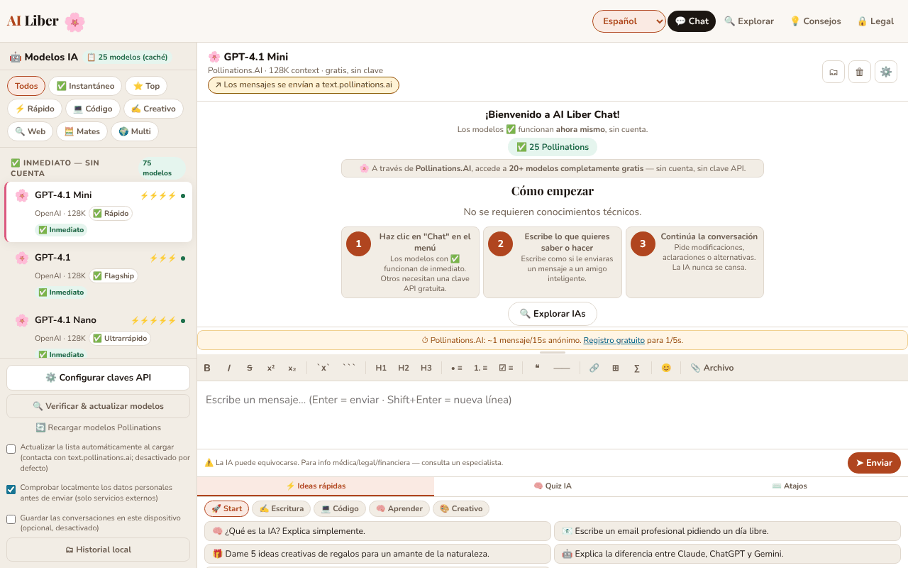

# AI Liber — La inteligencia artificial para todos

[English](README.md) · [Română](README.ro.md) · [Français](README.fr.md) · [Italiano](README.it.md) · **Español** · [Português](README.pt.md) · [Deutsch](README.de.md) · [Magyar](README.hu.md)

**Versión:** 1.4.1 · **Última actualización:** 2026-10-19

Idiomas de la interfaz: **Română, English, Français, Italiano, Español, Português (PT), Deutsch, Magyar**

Chatea con modelos de inteligencia artificial gratuitos o con tus propias claves API, además de una guía de las mejores IA gratuitas, en un único archivo HTML.

**Aplicación en línea:** https://chiuta.github.io/AI-Liber/

## Qué es

AI Liber es una aplicación de un único archivo (`index.html`) que ofrece una interfaz de chat única hacia varios proveedores de modelos de lenguaje: servicios gratuitos sin cuenta (por ejemplo Pollinations, DuckDuckGo AI Chat, AI Horde), servicios con clave API propia (OpenAI, Anthropic, Gemini, Groq, Mistral, OpenRouter, Perplexity), servidores locales (Ollama, LM Studio) y un modelo ejecutado directamente en el navegador mediante WebLLM. Incluye también una sección con un catálogo de IA gratuitas, un cuestionario y ideas de prompts.

## Funciones

- Chat con selector de modelo/proveedor, envío con el botón «➤ Enviar», detención de una solicitud en curso.
- Barra de formato Markdown (negrita, cursiva, tachado, código, lista, cita, tabla, etc.).
- Panel «Configurar claves API» para los proveedores que exigen una clave; las claves se guardan en local, ofuscadas con AES-GCM (la aplicación advierte explícitamente de que no es un cifrado robusto).
- Botón «Comprobar y actualizar modelos» para refrescar la lista de modelos.
- Compatibilidad con los servidores locales Ollama (`localhost:11434`) y LM Studio (`localhost:1234`) y con un modelo local en el navegador (WebLLM).
- Catálogo «Las mejores IA gratuitas», filtrable por categorías (Chat, Investigación, Imágenes, Vídeo IA, Medios, Código, Escritura, Productividad, Creativo) y por «Sin cuenta» / «Local (navegador)».
- Panel inferior con «⚡ Ideas rápidas» (prompts), «🧠 Cuestionario IA» y «⌨️ Atajos».
- Interfaz en 8 idiomas: rumano, inglés, francés, alemán, español, portugués, italiano, húngaro.
- Textos de privacidad (RGPD), términos e información sobre cookies/almacenamiento local, en cada idioma.

## Funciones de privacidad (desde la 1.1.0)

- **Comprobación local de datos personales antes de enviar** (`FFF.pii`): cuando el mensaje va a salir hacia un servicio externo (Pollinations, DuckDuckGo, AI Horde, API con clave), la aplicación busca en local correos electrónicos, teléfonos, IBAN (mod 97), CNP (dígito de control), tarjetas (Luhn), IP, claves/tokens. Si encuentra algo, no envía nada hasta que elijas: «Enmascarar los marcados y continuar», «Continuar sin enmascarar» o «Cancelar» (el texto permanece en el campo). Se puede desactivar desde la barra lateral (la preferencia se guarda). Para los modelos locales (WebLLM, Ollama, LM Studio) no se muestra el diálogo, porque el texto no sale del ordenador.
- **Indicador «qué sale de este dispositivo»** junto al selector de modelo: «Local: los mensajes permanecen en el navegador» (WebLLM), «Local: los mensajes van solo al servidor de este ordenador» (Ollama/LM Studio) o «Los mensajes salen hacia <host>» (servicios externos). En WebLLM, el indicador precisa que los archivos del modelo se descargan de la red en el primer uso, pero tu texto no sale.
- **Historial local de conversaciones, opcional (desactivado por defecto):** si marcas «Guardar las conversaciones en este dispositivo», las conversaciones se guardan en `localStorage` (claves `ailib_conv`, `ailib_hist`), con los datos personales enmascarados si lo deseas (botón «Buscar datos personales en el historial»). El panel «🗂 Historial local» tiene búsqueda local por significado (`FFF.search`: BM25, signos diacríticos, formas próximas, fragmentos resaltados), reanudación de una conversación en el chat, borrado por conversación, exportación a Markdown.
- **Copia cifrada del historial** mediante la etiqueta de transparencia (Exportar cifrado, contraseña). Las claves API y el secreto de sesión **no** entran en la copia (verificado en una prueba).

### Límites
- La detección de datos personales es heurística (los nombres propios y las direcciones tienen baja confianza). No garantiza la ausencia de datos sensibles.
- El enmascarado se aplica al texto del campo de mensaje, no a los archivos ya cargados en el chat.
- El historial tiene un tope de tamaño; al superarlo se eliminan las conversaciones más antiguas (con un mensaje).

**Kit FFF.** Del `fff-kit` (pegado en `index.html`, sin red) se usan los módulos `core, label, bundle, pii, search`: etiqueta de transparencia (pulsa la versión del pie de página), exportación/importación/borrado `.fff.json` con cifrado opcional AES-GCM + PBKDF2, detección local de datos personales y búsqueda local BM25. La política CSP **no se ha cambiado** respecto a la versión anterior salvo los hashes `sha256` de los scripts en línea (los estilos nuevos están en `<style>`, cubierto por el `style-src 'unsafe-inline'` ya presente; no se ha añadido ningún host nuevo). Las traducciones de los textos nuevos a fr/it/es/pt/hu/de son automáticas y **no están verificadas por nativos**. La detección de datos personales es heurística: puede fallar o señalar por error; no sustituye tu propia comprobación.

## Manual de uso

1. Abre la aplicación y elige el idioma en el selector de idioma (Română, English, Français, Deutsch, Español, Português, Italiano, Magyar).
2. Elige un modelo de la lista. Los modelos marcados «Sin cuenta» no piden clave.
3. Para un proveedor con clave: pulsa «⚙️ Configurar claves API», introduce la clave del proveedor deseado y cierra la ventana.
4. Escribe el mensaje en el campo de texto y pulsa Intro o «➤ Enviar». Mayús+Intro inserta un salto de línea.
5. Formato: Ctrl+B (negrita), Ctrl+I (cursiva), Ctrl+Z (deshacer); Esc cierra las ventanas; ↑↓ navegan por la lista de modelos.
6. Para los modelos locales: inicia Ollama con `OLLAMA_ORIGINS=* ollama serve` o el servidor de LM Studio en el puerto 1234, y luego elige el modelo local.
7. Usa «⚡ Ideas rápidas», «🧠 Cuestionario IA» o la sección «Las mejores IA gratuitas» para inspirarte y descubrir servicios.
8. Para borrar los datos, usa las opciones descritas en la ventana de privacidad o vacía los datos del sitio en el navegador.

## Privacidad y red

La aplicación **no funciona estrictamente sin conexión**: el chat solo funciona contactando con los servicios que elijas.

- **Persistencia de las claves API:** las claves se cifran (AES-GCM) con un secreto aleatorio guardado en `sessionStorage`; en la práctica sobreviven a la recarga de la misma pestaña, pero **no a una pestaña nueva ni al reinicio del navegador** (el secreto se pierde, las claves cifradas quedan ilegibles en `localStorage`), por lo que hay que volver a introducirlas. Verificado con una prueba (recarga: la clave permanece; pestaña nueva: vacío).
- **Almacenamiento local (localStorage):** el idioma (`ailib_lang`), las claves API ofuscadas (`aik_enc_*`, `aik_*`) con una sal (`ailib_ksalt`), una lista local de modelos que devolvieron error 404 (`ailib_404`), una preferencia de interfaz (`ailib_sbw`), la opción de actualización automática de la lista de modelos (`ailib_pollauto`, solo si la marcas). En `sessionStorage`: un secreto de sesión (`ailib_ssec`). Además, la preferencia de comprobación de datos personales (`ailib_piiguard`) y, solo si marcas la opción, el historial local (`ailib_hist`, `ailib_conv`).
- **Al cargar la página:** no se envía ninguna solicitud automática a Pollinations. La lista en vivo de modelos (`https://text.pollinations.ai/models`) solo se solicita si pulsas «Recargar los modelos de Pollinations» / «Comprobar y actualizar modelos» o marcas explícitamente, en la barra lateral, «Actualizar automáticamente la lista al iniciar» (opt-in, desactivado por defecto; la preferencia se guarda en `ailib_pollauto`). Hasta entonces se usa el catálogo local de la página. Cuando una respuesta contiene fórmulas (`$…$`), KaTeX se carga desde `cdn.jsdelivr.net` (versión fijada, con comprobación de integridad SRI).
- **Hosts de terceros contactados, solo tras una acción tuya (enviar un mensaje, recargar la lista, activar WebLLM):** `text.pollinations.ai`, `auth.pollinations.ai` (Pollinations); `duckduckgo.com` (DuckDuckGo AI Chat); `aihorde.net` (AI Horde); `api.openai.com`, `api.anthropic.com`, `generativelanguage.googleapis.com`, `api.perplexity.ai` y otras API de proveedores, solo si usas la clave correspondiente; `esm.run` (carga de WebLLM `@mlc-ai/web-llm@0.2.84`, solo cuando activas el modelo en el navegador) y, según el modelo, la descarga de los pesos desde los hosts de WebLLM.
- Tus mensajes se envían al proveedor elegido; se aplican sus políticas. Las claves se envían únicamente al proveedor al que pertenecen.
- Los archivos cargados en el chat se procesan en local en el navegador (`vendor/mammoth.browser.min.js` para .docx, `vendor/pdfjs/` para PDF), pero el texto extraído llega al proveedor elegido junto con el mensaje. Los catálogos contienen enlaces externos (solo navegación, al hacer clic).
- **CSP:** el script en línea solo se permite mediante hash `sha256` (sin `'unsafe-inline'` en `script-src`); los eventos de la interfaz los gestiona un despachador delegado (`data-onclick`, `data-onchange`, `data-oninput`, `data-onkeydown` + `data-arg`), sin atributos `on*` en línea. **Tras cualquier cambio del script, recalcula el hash en la meta CSP.** Los hosts permitidos en `script-src` (`esm.run`, `cdn.jsdelivr.net`) siguen ahí para WebLLM y KaTeX, cargados solo por acción tuya.
- Los servidores locales (`localhost`) solo se contactan si los seleccionas; desde páginas HTTPS el navegador puede bloquear las llamadas a `http://localhost` (contenido mixto).

## Limitaciones

Las respuestas de la IA pueden ser erróneas; la aplicación muestra bajo el campo de mensaje la advertencia «AI can make mistakes. For medical/legal/financial info — consult a specialist» (en el idioma de la interfaz). Los mensajes los tratan los proveedores elegidos, conforme a sus políticas.

## Ejecución local / sin conexión

Descarga `index.html` y ábrelo en un navegador. La interfaz, el catálogo, el cuestionario y las guías funcionan sin internet; para cualquier respuesta del chat necesitas conexión con el proveedor elegido (o un servidor local Ollama/LM Studio iniciado en tu ordenador).

## Licencia

MIT — consulta el archivo LICENSE

## Auditoría

Auditoría: 2026-10-10 (ronda 2: 2026-10-11) — `fetchPollModels()` es ahora opt-in (ya no se ejecuta al iniciar ni en `visibilitychange` sin tu consentimiento); el mensaje de la interfaz sobre las claves dice explícitamente que solo duran lo que dura la sesión de la pestaña; KaTeX desde cdn.jsdelivr.net (index.html:~7063). La representación Markdown de las respuestas de la IA está protegida contra XSS (probado con ``, `javascript:`, atributos inyectados en href, fórmulas). Correcciones de contraste y foco.

## Autor

Alexio — Alexandru-Ionuț Chiuță, contacto: alexio@trom.tf. La aplicación se ofrece en el espíritu del movimiento trade-free TROM (trom.tf); el apoyo voluntario es opcional.

## Resumen

AI Liber es un front-end de chat HTML de un único archivo para servicios de IA gratuitos sin cuenta, API con clave propia, servidores locales Ollama/LM Studio y un modelo WebLLM en el navegador, además de un directorio de herramientas de IA gratuitas, un cuestionario y ideas de prompts. Interfaz en 8 idiomas. Las claves se guardan en localStorage (ofuscadas con AES-GCM, no un cifrado robusto). El chat requiere acceso a internet hacia el proveedor elegido. Licencia MIT.

## Fuentes verificadas el 11.10.2026
- DuckDuckGo AI Chat (duck.ai), modelos gratuitos sin cuenta: TechRadar, «Duck.ai by DuckDuckGo review», 13 de julio de 2026 (https://techradar.com/pro/duck-ai-review): Claude 4.5 Haiku, GPT-4o mini, GPT-5 mini, gpt-oss-120b, Llama 4 Scout, Mistral Small 3 24B. Los modelos fijados en el código de la aplicación para DuckDuckGo (Claude 3 Haiku, Llama 3.1 70B, Mixtral 8x7B, o3-mini) pueden retirarse; los ID de API de DuckDuckGo no se pueden verificar sin red y no se han cambiado (la aplicación tiene «Comprobar y actualizar modelos» y la lista de modelos que dan 404).
- Pollinations (texto, sin clave, ~1 solicitud/15 s en modo anónimo, clave gratuita opcional): https://free-llm.com/provider/pollinations-ai (página actualizada en octubre de 2026).
- Los textos jurídicos (versión «v1.0 · 12 de abril de 2026») no se modificaron en esta ronda; su fecha es decisión del autor y no se ha cambiado.

## Historial / Registro de cambios
- **1.4.1 — 2026-10-19:** la comprobación de datos personales antes de enviar, el indicador «qué sale» y el historial local opcional descritos arriba (introducidos en la 1.1.0) están presentes en la versión actual: se habían eliminado por error en una limpieza anterior y se reimplementaron con el mismo comportamiento y pruebas nuevas (`tests/fff-r8.test.mjs`). La interfaz (incluidas las descripciones de los modelos) está disponible en 8 idiomas, húngaro incluido.
- **1.1.0 — 2026-10-14:** comprobación local de datos personales antes de enviar (`FFF.pii`), indicador «qué sale», historial local opcional con búsqueda (`FFF.search`), copia cifrada `.fff.json` (`FFF.bundle`), etiqueta de transparencia; pruebas en `tests/fff-r8.test.mjs`.
- 1.0.0 — 2026-10-12: la versión y la fecha de la última actualización se muestran en la aplicación
- **11 de octubre de 2026 (ronda 7)** — en el panel de claves API la nota de seguridad ya no muestra literalmente `<strong>NOT</strong>` (se quitaron las etiquetas HTML del texto en los 7 idiomas); el encabezado «🤖 Modelos IA» del panel lateral y las insignias «N modelos (cache/live)» se traducen ahora al cambiar de idioma; las etiquetas de especificaciones de los modelos («El más rápido», «Razonamiento», «Programación», etc.) están traducidas a EN/FR/IT/ES/PT/DE; las guías de los proveedores en Ajustes aparecen en inglés (no en rumano) en los idiomas distintos del RO; la CSP conserva el hash recalculado. Los textos jurídicos no se modificaron. 0 errores, axe 0 infracciones a 1280×800 y 360×740.
- **11 de octubre de 2026 (segunda intervención)** — los 112 atributos `on*` en línea (85 manejadores distintos) se sustituyeron por un despachador delegado a nivel de `body`, y la CSP ya no tiene `'unsafe-inline'` en `script-src` (hash `sha256`); la paridad de comportamiento se verificó automáticamente en 12 estados de la aplicación (más de 6.800 eventos disparados en la versión antigua y en la nueva, mismas llamadas y argumentos, 0 diferencias) y con la CSP activa (0 errores, 0 infracciones). El catálogo de modelos se reconstruye ahora al cambiar de idioma (las etiquetas «se ejecuta en el navegador», «Local en el navegador», los grupos de razonamiento ya no se quedan en el idioma anterior), las guías de los proveedores en Ajustes tienen traducción al inglés (en los demás idiomas siguen en rumano), la etiqueta y las aria-label del widget de apoyo están traducidas a los 7 idiomas, y las ofertas de créditos de prueba en las guías de OpenAI/Anthropic se formulan como variables («comprueba en el sitio»), no como promesas.
- **11 de octubre de 2026** — la pantalla de bienvenida se regenera al cambiar de idioma (antes se quedaba en rumano en una interfaz inglesa/francesa, etc.); el banner ya no enumera modelos perecederos (GPT-4, Llama 70B, DeepSeek R1…); la guía de DuckDuckGo está fechada y con advertencia sobre modelos retirados; nota fechada en «Explorar» sobre planes gratuitos cambiantes; mensaje claro «estás sin conexión» (7 idiomas) en lugar de un error de red cuando eliges un modelo que necesita internet; a 360 px ya no hay desbordamientos horizontales (barra superior, página Legal).
- Accesibilidad: el contenido está en `main` (incluida la página Legal), título `h1` oculto visualmente, orden de los títulos corregido, el widget de apoyo tiene el rol `complementary`; axe-core: 0 infracciones a 1280×800 y 360×740 en las páginas Chat, Explorar, Consejos y Legal. Los 113 atributos `onclick`/`onchange` en línea permanecieron (la CSP permite `'unsafe-inline'`; refactorizarlos sería arriesgado sin pruebas de regresión extensas). La aplicación no tiene número de versión.
