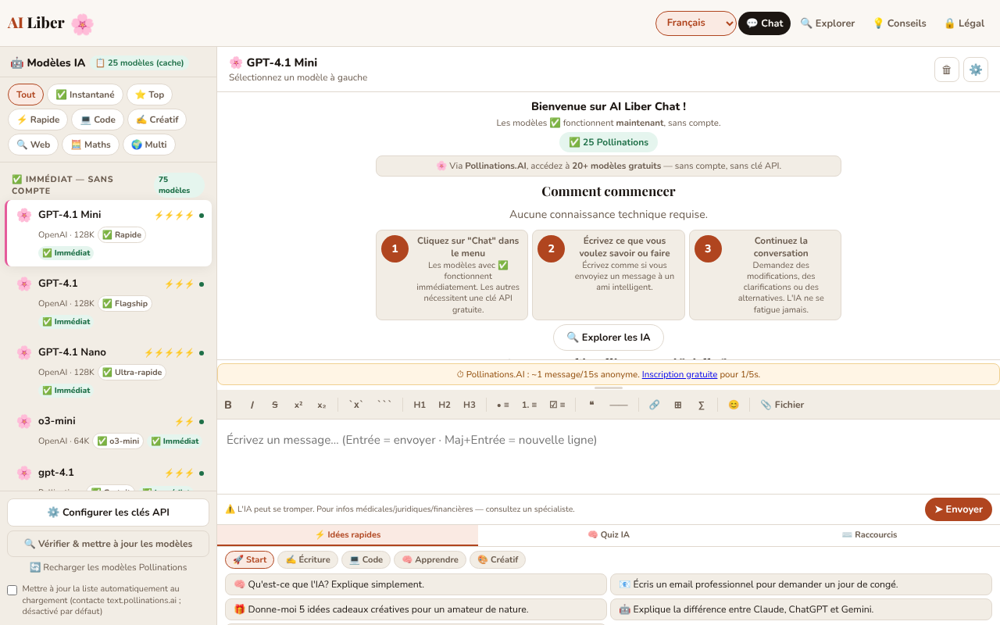

# AI Liber — L'intelligence artificielle pour tous

[English](README.md) · [Română](README.ro.md) · **Français** · [Italiano](README.it.md) · [Español](README.es.md) · [Português](README.pt.md) · [Deutsch](README.de.md) · [Magyar](README.hu.md)

**Version :** 1.4.8 · **Dernière mise à jour :** 2026-10-23

Langues de l'interface : **Română, English, Français, Italiano, Español, Português (PT), Deutsch, Magyar**

Discutez avec des modèles d'intelligence artificielle gratuits ou avec vos propres clés API, avec en plus un guide des meilleures IA gratuites, dans un seul fichier HTML.

**Application en ligne :** https://chiuta.github.io/AI-Liber/

## Ce que c'est

AI Liber est une application en un seul fichier (`index.html`) qui offre une interface de chat unique vers plusieurs fournisseurs de modèles de langage : des services gratuits sans compte (par exemple Pollinations, DuckDuckGo AI Chat, AI Horde), des services avec votre propre clé API (OpenAI, Anthropic, Gemini, Groq, Mistral, OpenRouter, Perplexity), des serveurs locaux (Ollama, LM Studio) et un modèle exécuté directement dans le navigateur via WebLLM. Elle comprend aussi une section avec un catalogue d'IA gratuites, un quiz et des idées de prompts.

## Fonctions

- Chat avec sélecteur de modèle/fournisseur, envoi avec le bouton « ➤ Envoyer », arrêt d'une requête en cours.
- Barre de mise en forme Markdown (gras, italique, barré, code, liste, citation, tableau, etc.).
- Panneau « Configurer les clés API » pour les fournisseurs qui exigent une clé ; les clés sont conservées localement, obscurcies avec AES-GCM (l'application avertit explicitement qu'il ne s'agit pas d'un chiffrement robuste).
- Bouton « Vérifier & mettre à jour les modèles » pour actualiser la liste des modèles.
- Prise en charge des serveurs locaux Ollama (`localhost:11434`) et LM Studio (`localhost:1234`) et d'un modèle local dans le navigateur (WebLLM).
- Catalogue « Les meilleures IA gratuites », filtrable par catégories (Chat, Recherche, Images, Vidéo IA, Médias, Code, Écriture, Productivité, Créatif) et par « Sans compte » / « Local (navigateur) ».
- Panneau inférieur avec « ⚡ Idées rapides » (prompts), « 🧠 Quiz IA » et « ⌨️ Raccourcis ».
- Interface en 8 langues : roumain, anglais, français, allemand, espagnol, portugais, italien, hongrois.
- Textes de confidentialité (RGPD), conditions et informations sur les cookies/le stockage local, dans chaque langue.

## Fonctions de confidentialité (depuis la 1.1.0)

- **Vérification locale des données personnelles avant l'envoi** (`FFF.pii`) : lorsque le message s'apprête à partir vers un service externe (Pollinations, DuckDuckGo, AI Horde, API avec clé), l'application recherche localement des e-mails, des téléphones, des IBAN (mod 97), des CNP (chiffre de contrôle), des cartes (Luhn), des IP, des clés/jetons. Si elle trouve quelque chose, elle n'envoie rien tant que vous n'avez pas choisi : « Masquer les éléments cochés et continuer », « Continuer sans masquer » ou « Annuler » (le texte reste dans le champ). Elle peut être désactivée depuis la barre latérale (la préférence est conservée). Pour les modèles locaux (WebLLM, Ollama, LM Studio), la boîte de dialogue n'est pas affichée, car le texte ne quitte pas l'ordinateur.
- **Indicateur « ce qui quitte cet appareil »** à côté du sélecteur de modèle : « Local : les messages restent dans le navigateur » (WebLLM), « Local : les messages vont seulement au serveur de cet ordinateur » (Ollama/LM Studio) ou « Les messages partent vers <hôte> » (services externes). Pour WebLLM, l'indicateur précise que les fichiers du modèle sont téléchargés depuis le réseau à la première utilisation, mais que votre texte ne part pas.
- **Historique local des conversations, facultatif (désactivé par défaut) :** si vous cochez « Enregistrer les conversations sur cet appareil », les conversations sont conservées dans `localStorage` (clés `ailib_conv`, `ailib_hist`), avec les données personnelles masquées si vous le souhaitez (bouton « Rechercher des données personnelles dans l'historique »). Le panneau « 🗂 Historique local » offre une recherche locale par sens (`FFF.search` : BM25, signes diacritiques, formes proches, fragments mis en évidence), la reprise d'une conversation dans le chat, la suppression par conversation, l'export Markdown.
- **Copie chiffrée de l'historique** via l'étiquette de transparence (Exporter chiffré, mot de passe). Les clés API et le secret de session n'entrent **pas** dans la copie (vérifié par un test).

### Limites
- La détection des données personnelles est heuristique (les noms propres et les adresses ont une faible confiance). Elle ne garantit pas l'absence de données sensibles.
- Le masquage s'applique au texte du champ de message, pas aux fichiers déjà téléversés dans le chat.
- L'historique a un plafond de taille ; en cas de dépassement, les conversations les plus anciennes sont supprimées (avec un message).

**Kit FFF.** Du `fff-kit` (collé dans `index.html`, sans réseau), on utilise les modules `core, label, bundle, pii, search` : étiquette de transparence (appuyez sur la version dans le pied de page), export/import/suppression `.fff.json` avec chiffrement facultatif AES-GCM + PBKDF2, détection locale de données personnelles et recherche locale BM25. La politique CSP **n'a pas été modifiée** par rapport à la version précédente, hormis les empreintes `sha256` des scripts en ligne (les nouveaux styles sont dans `<style>`, couvert par le `style-src 'unsafe-inline'` déjà présent ; aucun nouvel hôte n'a été ajouté). Les traductions des nouveaux textes en fr/it/es/pt/hu/de sont automatiques et **non vérifiées par des natifs**. La détection de données personnelles est heuristique : elle peut manquer ou signaler à tort ; elle ne remplace pas votre propre vérification.

## Mode d'emploi

1. Ouvrez l'application et choisissez la langue dans le sélecteur de langue (Română, English, Français, Deutsch, Español, Português, Italiano, Magyar).
2. Choisissez un modèle dans la liste. Les modèles marqués « Sans compte » ne demandent pas de clé.
3. Pour un fournisseur avec clé : appuyez sur « ⚙️ Configurer les clés API », saisissez la clé du fournisseur souhaité et fermez la fenêtre.
4. Écrivez le message dans le champ de texte et appuyez sur Entrée ou sur « ➤ Envoyer ». Maj+Entrée insère un saut de ligne.
5. Mise en forme : Ctrl+B (gras), Ctrl+I (italique), Ctrl+Z (annuler) ; Échap ferme les fenêtres ; ↑↓ naviguent dans la liste des modèles.
6. Pour les modèles locaux : lancez Ollama avec `OLLAMA_ORIGINS=* ollama serve` ou le serveur LM Studio sur le port 1234, puis choisissez le modèle local.
7. Utilisez « ⚡ Idées rapides », « 🧠 Quiz IA » ou la section « Les meilleures IA gratuites » pour vous inspirer et découvrir des services.
8. Pour supprimer les données, utilisez les options décrites dans la fenêtre de confidentialité ou videz les données du site dans le navigateur.

## Confidentialité et réseau

L'application **n'est pas strictement hors ligne** : le chat ne fonctionne qu'en contactant les services que vous choisissez.

- **Persistance des clés API :** les clés sont chiffrées (AES-GCM) avec un secret aléatoire conservé dans `sessionStorage` ; en pratique elles survivent au rechargement du même onglet, mais **pas à un nouvel onglet ni au redémarrage du navigateur** (le secret est perdu, les clés chiffrées restent illisibles dans `localStorage`), elles doivent donc être ressaisies. Vérifié par un test (rechargement : la clé reste ; nouvel onglet : vide).
- **Stockage local (localStorage) :** la langue (`ailib_lang`), les clés API obscurcies (`aik_enc_*`, `aik_*`) avec un sel (`ailib_ksalt`), une liste locale des modèles ayant renvoyé une erreur 404 (`ailib_404`), une préférence d'interface (`ailib_sbw`), l'option de mise à jour automatique de la liste des modèles (`ailib_pollauto`, seulement si vous la cochez). Dans `sessionStorage` : un secret de session (`ailib_ssec`). Ainsi que la préférence de vérification des données personnelles (`ailib_piiguard`) et, seulement si vous cochez l'option, l'historique local (`ailib_hist`, `ailib_conv`).
- **Au chargement de la page :** aucune requête automatique n'est envoyée à Pollinations. La liste en direct des modèles (`https://text.pollinations.ai/models`) n'est demandée que si vous appuyez sur « Recharger les modèles Pollinations » / « Vérifier & mettre à jour les modèles » ou si vous cochez explicitement, dans la barre latérale, « Mettre à jour automatiquement la liste au démarrage » (opt-in, désactivé par défaut ; la préférence est conservée dans `ailib_pollauto`). D'ici là, on utilise le catalogue local de la page. Lorsqu'une réponse contient des formules (`$…$`), KaTeX est chargé depuis `vendor/` (même origine, avec vérification d'intégrité SRI).
- **Hôtes tiers contactés, seulement après une action de votre part (envoi d'un message, rechargement de la liste, activation de WebLLM) :** `text.pollinations.ai`, `auth.pollinations.ai` (Pollinations) ; `duckduckgo.com` (DuckDuckGo AI Chat) ; `aihorde.net` (AI Horde) ; `api.openai.com`, `api.anthropic.com`, `generativelanguage.googleapis.com`, `api.perplexity.ai` et les autres API de fournisseurs, uniquement si vous utilisez la clé correspondante ; `raw.githubusercontent.com/mlc-ai/binary-mlc-llm-libs/00fe7a40e57e5e8eb9fef87526a4bf28ad5846c0/` (la bibliothèque du modèle `.wasm`, commit figé, vérifiée par WebLLM avec une SRI SHA-256 ; uniquement lorsque vous activez le modèle dans le navigateur) et `huggingface.co/mlc-ai/` (+ `*.huggingface.co`, `*.hf.co`) pour les poids, qui n'ont pas d'empreinte figée. WebLLM lui-même (`@mlc-ai/web-llm@0.2.84`) est dans `vendor/`, pas sur un CDN. Selon le modèle, le téléchargement des poids depuis les hôtes de WebLLM.
- Vos messages sont envoyés au fournisseur choisi ; ses politiques s'appliquent. Les clés ne sont envoyées qu'au fournisseur auquel elles appartiennent.
- Les fichiers téléversés dans le chat sont traités localement dans le navigateur (`vendor/mammoth.browser.min.js` pour .docx, `vendor/pdfjs/` pour PDF), mais le texte extrait parvient au fournisseur choisi avec le message. Les catalogues contiennent des liens externes (navigation uniquement, au clic).
- **CSP :** le script en ligne n'est autorisé que par empreinte `sha256` (sans `'unsafe-inline'` dans `script-src`) ; les événements de l'interface sont gérés par un répartiteur délégué (`data-onclick`, `data-onchange`, `data-oninput`, `data-onkeydown` + `data-arg`), sans attributs `on*` en ligne. **Après toute modification du script, recalculez l'empreinte dans la méta CSP.** `script-src` n'autorise que `'self'` (plus l'empreinte du script en ligne) : WebLLM, KaTeX, pdf.js et mammoth sont chargés depuis `vendor/` ; aucun hôte de CDN n'est autorisé. Voir `NOTICE.md`.
- Les serveurs locaux (`localhost`) ne sont contactés que si vous les sélectionnez ; depuis des pages HTTPS, le navigateur peut bloquer les appels vers `http://localhost` (contenu mixte).

## Limitations

Les réponses de l'IA peuvent être erronées ; l'application affiche sous le champ de message l'avertissement « AI can make mistakes. For medical/legal/financial info — consult a specialist » (dans la langue de l'interface). Les messages sont traités par les fournisseurs choisis, conformément à leurs politiques.

## Exécution locale / hors ligne

Téléchargez `index.html` et ouvrez-le dans un navigateur. L'interface, le catalogue, le quiz et les guides fonctionnent sans internet ; pour toute réponse de chat, il vous faut une connexion au fournisseur choisi (ou un serveur local Ollama/LM Studio lancé sur votre ordinateur).

## Licence

MIT — voir le fichier LICENSE

## Audit

Audit : 2026-10-10 (tour 2 : 2026-10-11) — `fetchPollModels()` est désormais opt-in (il ne s'exécute plus au démarrage ni lors de `visibilitychange` sans votre accord) ; le message de l'interface sur les clés indique explicitement qu'elles ne durent que le temps de la session de l'onglet ; KaTeX depuis cdn.jsdelivr.net (index.html:~7063). L'affichage Markdown des réponses de l'IA est protégé contre le XSS (testé avec ``, `javascript:`, attributs injectés dans href, formules). Corrections de contraste et de focus.

## Auteur

Alexio — Alexandru-Ionuț Chiuță, contact : alexio@trom.tf. L'application est offerte dans l'esprit du mouvement trade-free TROM (trom.tf) ; le soutien volontaire est facultatif.

## Résumé

AI Liber est une interface de chat HTML en un seul fichier pour des services d'IA gratuits sans compte, des API avec votre propre clé, des serveurs locaux Ollama/LM Studio et un modèle WebLLM dans le navigateur, avec en plus un répertoire d'outils d'IA gratuits, un quiz et des idées de prompts. Interface en 8 langues. Les clés sont conservées dans localStorage (obscurcies par AES-GCM, pas un chiffrement robuste). Le chat nécessite un accès à internet vers le fournisseur choisi. Licence MIT.

## Sources vérifiées le 11.10.2026
- DuckDuckGo AI Chat (duck.ai), modèles gratuits sans compte : TechRadar, « Duck.ai by DuckDuckGo review », 13 juillet 2026 (https://techradar.com/pro/duck-ai-review) : Claude 4.5 Haiku, GPT-4o mini, GPT-5 mini, gpt-oss-120b, Llama 4 Scout, Mistral Small 3 24B. Les modèles codés en dur dans l'application pour DuckDuckGo (Claude 3 Haiku, Llama 3.1 70B, Mixtral 8x7B, o3-mini) peuvent être retirés ; les ID d'API de DuckDuckGo ne peuvent pas être vérifiés sans réseau et n'ont pas été modifiés (l'application dispose de « Vérifier & mettre à jour les modèles » et de la liste des modèles qui renvoient 404).
- Pollinations (texte, sans clé, ~1 requête/15 s en anonyme, clé gratuite facultative) : https://free-llm.com/provider/pollinations-ai (page mise à jour en octobre 2026).
- Les textes juridiques (version « v1.0 · 12 avril 2026 ») n'ont pas été modifiés lors de ce tour ; leur date relève d'une décision de l'auteur et n'a pas été changée.

## Historique / Journal des modifications

### 1.4.7 — 2026-10-22
- Le chargement des bibliothèques ne fait plus confiance à un CDN : WebLLM 0.2.84 (et KaTeX 0.16.9) sont dans `vendor/` et chargés depuis la même origine ; les bibliothèques de modèle (`.wasm`) viennent d'un commit figé de `binary-mlc-llm-libs` et sont vérifiées par SRI SHA-256 (refusées en cas de différence). La CSP n'autorise plus `esm.run`, `cdn.jsdelivr.net` ni l'ensemble de `raw.githubusercontent.com`.
- Les identifiants des modèles Gemma 2 correspondent désormais à WebLLM 0.2.84 (`gemma-2-*-it-q4f16_1-MLC`). Nouveau `NOTICE.md`. Taille ajoutée : ~6,4 Mo.

- 1.4.6 — 2026-10-22 : fff-kit 1.1.4 : cibles tactiles et taille de texte minimale
- 1.4.5 — 2026-10-22 : fff-kit 1.1.2 : PBKDF2 600 000 itérations, protection anti-clickjacking
- 1.4.4 — 2026-10-22 : Boîte de consentement avant le premier message vers un service externe sans clé (Pollinations, DuckDuckGo, AI Horde) ; la confirmation de suppression des modèles utilise une boîte intégrée au lieu de window.confirm ; texte ≥ 12 px et cases à cocher plus grandes sur mobile.

- 1.4.3 — 2026-10-22: **correctif** : les noms d’AI Horde et des modèles locaux (LM Studio, Ollama) ainsi que la carte AI Horde de la grille d’exploration suivent désormais la langue choisie.
- **1.4.2 (22 octobre 2026) :** Le titre de la page suit désormais la langue de l'interface ; les étiquettes de la liste des modèles et le catalogue Explore sont reconstruits au démarrage dans la langue enregistrée (ils restaient en roumain après un rechargement) ; le texte de la boîte de vérification des modèles est traduit.
- **1.4.1 — 2026-10-19 :** la vérification des données personnelles avant l'envoi, l'indicateur « ce qui part » et l'historique local facultatif décrits ci-dessus (introduits dans la 1.1.0) sont présents dans la version actuelle : ils avaient été supprimés par erreur lors d'un nettoyage antérieur et ont été réimplémentés avec le même comportement et de nouveaux tests (`tests/fff-r8.test.mjs`). L'interface (y compris les descriptions des modèles) est disponible en 8 langues, hongrois compris.
- **1.1.0 — 2026-10-14 :** vérification locale des données personnelles avant l'envoi (`FFF.pii`), indicateur « ce qui part », historique local facultatif avec recherche (`FFF.search`), copie chiffrée `.fff.json` (`FFF.bundle`), étiquette de transparence ; tests dans `tests/fff-r8.test.mjs`.
- 1.0.0 — 2026-10-12 : la version et la date de la dernière mise à jour sont affichées dans l'application
- **11 octobre 2026 (tour 7)** — dans le panneau des clés API, la note de sécurité n'affiche plus littéralement `<strong>NOT</strong>` (les balises HTML ont été retirées du texte dans les 7 langues) ; l'en-tête « 🤖 Modèles IA » du panneau latéral et les badges « N modèles (cache/live) » se traduisent désormais au changement de langue ; les étiquettes de spécifications des modèles (« Le plus rapide », « Raisonnement », « Programmation », etc.) sont traduites en EN/FR/IT/ES/PT/DE ; les guides des fournisseurs dans les Paramètres apparaissent en anglais (et non en roumain) dans les langues autres que RO ; la CSP conserve l'empreinte recalculée. Les textes juridiques n'ont pas été modifiés. 0 erreur, axe 0 violation à 1280×800 et 360×740.
- **11 octobre 2026 (deuxième intervention)** — les 112 attributs `on*` en ligne (85 gestionnaires distincts) ont été remplacés par un répartiteur délégué au niveau de `body`, et la CSP n'a plus `'unsafe-inline'` dans `script-src` (empreinte `sha256`) ; la parité de comportement a été vérifiée automatiquement sur 12 états de l'application (plus de 6 800 événements déclenchés sur l'ancienne et la nouvelle version, mêmes appels et mêmes arguments, 0 différence) et avec la CSP active (0 erreur, 0 violation). Le catalogue de modèles est désormais reconstruit au changement de langue (les étiquettes « s'exécute dans le navigateur », « Local dans le navigateur », les groupes de raisonnement ne restent plus dans l'ancienne langue), les guides des fournisseurs dans les Paramètres ont une traduction en anglais (dans les autres langues ils restent en roumain), l'étiquette et les aria-labels du widget de soutien sont traduits dans les 7 langues, et les offres de crédits d'essai dans les guides OpenAI/Anthropic sont formulées comme des variables (« vérifiez sur le site »), et non comme des promesses.
- **11 octobre 2026** — l'écran d'accueil est régénéré au changement de langue (auparavant il restait en roumain dans une interface anglaise/française, etc.) ; la bannière n'énumère plus de modèles périssables (GPT-4, Llama 70B, DeepSeek R1…) ; le guide DuckDuckGo est daté et accompagné d'un avertissement sur les modèles retirés ; note datée dans « Explorer » sur les offres gratuites changeantes ; message clair « vous êtes hors ligne » (7 langues) au lieu d'une erreur réseau lorsque vous choisissez un modèle qui a besoin d'internet ; à 360 px, il n'y a plus de débordements horizontaux (barre du haut, page Mentions légales).
- Accessibilité : le contenu est dans `main` (y compris la page Mentions légales), titre `h1` masqué visuellement, ordre des titres corrigé, le widget de soutien a le rôle `complementary` ; axe-core : 0 violation à 1280×800 et 360×740 sur les pages Chat, Explorer, Conseils et Mentions légales. Les 113 attributs `onclick`/`onchange` en ligne sont restés (la CSP autorise `'unsafe-inline'` ; les refactoriser serait risqué sans tests de régression étendus). L'application n'a pas de numéro de version.
