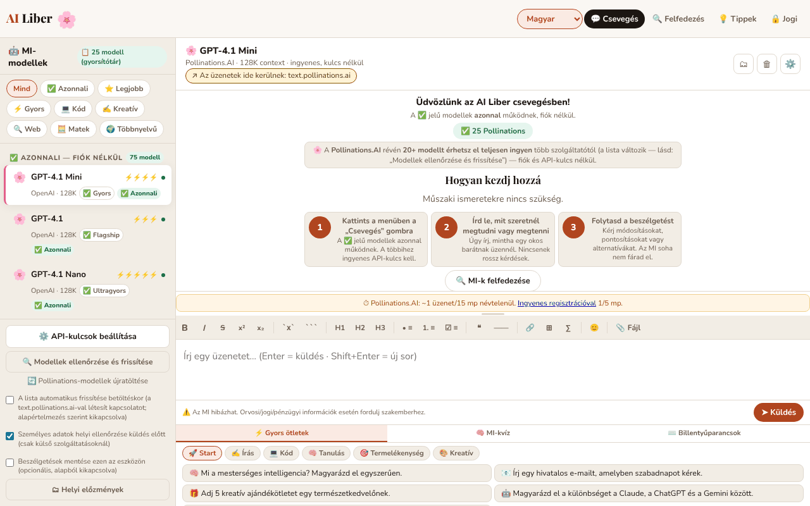

# AI Liber — Mesterséges intelligencia mindenkinek

[English](README.md) · [Română](README.ro.md) · [Français](README.fr.md) · [Italiano](README.it.md) · [Español](README.es.md) · [Português](README.pt.md) · [Deutsch](README.de.md) · **Magyar**

**Verzió:** 2.2.1 · **Utolsó frissítés:** 2026-10-31

A felület nyelvei: **Română, English, Français, Italiano, Español, Português (PT), Deutsch, Magyar**

Csevegj ingyenes mesterséges intelligencia modellekkel vagy a saját API-kulcsaiddal, emellett útmutató a legjobb ingyenes MI-khez, egyetlen HTML-fájlban.

**Online alkalmazás:** https://chiuta.github.io/AI-Liber/

## Mi ez

Az AI Liber egyfájlos alkalmazás (`index.html`), amely egyetlen csevegőfelületet kínál több nyelvimodell-szolgáltatóhoz: fiók nélküli ingyenes szolgáltatások (például Pollinations, DuckDuckGo AI Chat, AI Horde), saját API-kulcsot igénylő szolgáltatások (OpenAI, Anthropic, Gemini, Groq, Mistral, OpenRouter, Perplexity), helyi szerverek (Ollama, LM Studio) és közvetlenül a böngészőben, a WebLLM-en keresztül futtatott modell. Tartalmaz továbbá egy szakaszt az ingyenes MI-k katalógusával, egy kvízt és prompt-ötleteket.

## Funkciók

- Csevegés modell-/szolgáltatóválasztóval, küldés a „➤ Küldés” gombbal, folyamatban lévő kérés leállítása.
- Markdown formázósáv (félkövér, dőlt, áthúzott, kód, lista, idézet, táblázat stb.).
- „API-kulcsok beállítása” panel a kulcsot igénylő szolgáltatókhoz; a kulcsokat helyben tárolja, AES-GCM-mel elfedve (az alkalmazás kifejezetten figyelmeztet, hogy ez nem erős titkosítás).
- „Modellek ellenőrzése és frissítése” gomb a modelllista frissítéséhez.
- Támogatás a helyi Ollama (`localhost:11434`) és LM Studio (`localhost:1234`) szerverekhez, valamint egy helyi, böngészőbeli modellhez (WebLLM).
- „A legjobb ingyenes MI-k” katalógus, kategóriák (Csevegés, Kutatás, Képek, MI-videó, Média, Kód, Írás, Termelékenység, Kreatív) és „Fiók nélkül” / „Helyi (böngésző)” szerint szűrhető.
- Alsó panel a „⚡ Gyors ötletek” (promptok), a „🧠 MI-kvíz” és a „⌨️ Gyorsbillentyűk” elemekkel.
- Felület 8 nyelven: román, angol, francia, német, spanyol, portugál, olasz, magyar.
- Adatvédelmi szövegek (GDPR), feltételek és tájékoztató a sütikről/helyi tárolásról, minden nyelven.

## Adatvédelmi funkciók (az 1.1.0 óta)

- **Személyes adatok helyi ellenőrzése küldés előtt** (`FFF.pii`): amikor az üzenet külső szolgáltatáshoz készül elmenni (Pollinations, DuckDuckGo, AI Horde, kulcsos API-k), az alkalmazás helyben keres e-mail-címeket, telefonszámokat, IBAN-t (mod 97), CNP-t (ellenőrző számjegy), kártyákat (Luhn), IP-címeket, kulcsokat/tokeneket. Ha talál valamit, semmit sem küld, amíg nem választasz: „A bejelöltek elfedése és folytatás”, „Folytatás elfedés nélkül” vagy „Mégse” (a szöveg a mezőben marad). Az oldalsávból kikapcsolható (a beállítás megmarad). A helyi modelleknél (WebLLM, Ollama, LM Studio) a párbeszédablak nem jelenik meg, mert a szöveg nem hagyja el a számítógépet.
- **„Mi hagyja el ezt az eszközt” jelző** a modellválasztó mellett: „Helyi: az üzenetek a böngészőben maradnak” (WebLLM), „Helyi: az üzenetek csak az ezen a számítógépen lévő szerverhez mennek” (Ollama/LM Studio) vagy „Az üzenetek ide mennek: <hoszt>” (külső szolgáltatások). A WebLLM esetében a jelző pontosítja, hogy a modellfájlok az első használatkor hálózatról töltődnek le, de a szöveged nem megy el.
- **Opcionális helyi beszélgetési előzmények (alapértelmezés szerint kikapcsolva):** ha bejelölöd a „Beszélgetések mentése ezen az eszközön” opciót, a beszélgetések a `localStorage`-ban maradnak (`ai-liber.conv`, `ai-liber.hist` kulcsok), a személyes adatok igény szerint elfedve (gomb: „Személyes adatok keresése az előzményekben”). A „🗂 Helyi előzmények” panel helyi, jelentés szerinti keresést kínál (`FFF.search`: BM25, diakritikus jelek, hasonló alakok, kiemelt részletek), beszélgetés folytatását a csevegésben, beszélgetésenkénti törlést, Markdown-exportot.
- **Az előzmények titkosított másolata** az átláthatósági címkén keresztül (Titkosított exportálás, jelszó). Az API-kulcsok és a munkamenet-titok **nem** kerülnek a másolatba (tesztben ellenőrizve).

### Korlátok
- A személyes adatok felismerése heurisztikus (a tulajdonnevek és a címek alacsony megbízhatóságúak). Nem garantálja az érzékeny adatok hiányát.
- Az elfedés az üzenetmezőben lévő szövegre vonatkozik, nem a már feltöltött fájlokra a csevegésben.
- Az előzményeknek méretkorlátja van; túllépéskor a legrégebbi beszélgetések eltávolításra kerülnek (üzenettel).

**FFF-készlet.** Az `fff-kit` (az `index.html` fájlba illesztve, hálózat nélkül) `core, label, bundle, pii, search` moduljait használja: átláthatósági címke (nyomd meg a verziót a láblécben), `.fff.json` export/import/törlés opcionális AES-GCM + PBKDF2 titkosítással, helyi személyesadat-felismerés és helyi BM25-keresés. A CSP-szabályzat az előző verzióhoz képest **nem változott**, kivéve a beágyazott szkriptek `sha256` ellenőrzőösszegeit (az új stílusok a `<style>` elemben vannak, amelyet a már meglévő `style-src 'unsafe-inline'` fed le; új hoszt nem került hozzáadásra). Az új szövegek fr/it/es/pt/hu/de fordításai automatikusak és **anyanyelvi beszélő nem ellenőrizte őket**. A személyes adatok felismerése heurisztikus: lehet, hogy elmulaszt valamit vagy tévesen jelez; nem helyettesíti a saját ellenőrzésedet.

## Használati útmutató

1. Nyisd meg az alkalmazást, és válaszd ki a nyelvet a nyelvválasztóból (Română, English, Français, Deutsch, Español, Português, Italiano, Magyar).
2. Válassz egy modellt a listából. A „Fiók nélkül” jelölésű modellek nem kérnek kulcsot.
3. Kulcsot igénylő szolgáltatónál: nyomd meg a „⚙️ API-kulcsok beállítása” gombot, add meg a kívánt szolgáltató kulcsát, és zárd be az ablakot.
4. Írd be az üzenetet a szövegmezőbe, és nyomd meg az Entert vagy a „➤ Küldés” gombot. A Shift+Enter új sort szúr be.
5. Formázás: Ctrl+B (félkövér), Ctrl+I (dőlt), Ctrl+Z (visszavonás); az Esc bezárja az ablakokat; a ↑↓ a modelllistában navigál.
6. Helyi modellekhez: indítsd el az Ollamát az `OLLAMA_ORIGINS=* ollama serve` paranccsal vagy az LM Studio szerverét az 1234-es porton, majd válaszd ki a helyi modellt.
7. Használd a „⚡ Gyors ötletek”, a „🧠 MI-kvíz” vagy „A legjobb ingyenes MI-k” szakaszt inspirációhoz és szolgáltatások felfedezéséhez.
8. Az adatok törléséhez használd az adatvédelmi ablakban leírt lehetőségeket, vagy töröld az oldal adatait a böngészőben.

## Adatvédelem és hálózat

Az alkalmazás **nem szigorúan offline**: a csevegés csak az általad választott szolgáltatások megkeresésével működik.

- **Az API-kulcsok megőrzése:** a kulcsok titkosítva vannak (AES-GCM) egy véletlenszerű titokkal, amely a `sessionStorage`-ban van; a gyakorlatban túlélik ugyanannak a lapnak az újratöltését, de **az új lapot vagy a böngésző újraindítását nem** (a titok elvész, a titkosított kulcsok olvashatatlanok maradnak a `localStorage`-ban), ezért újra be kell írni őket. Teszttel ellenőrizve (újratöltés: a kulcs megmarad; új lap: üres).
- **Helyi tárolás (localStorage):** a nyelv (`ai-liber.lang`), az elfedett API-kulcsok (`ai-liber.aik.enc_*`, `ai-liber.aik.*`) egy sóval (`ai-liber.ksalt`), a 404-es hibát adó modellek helyi listája (`ai-liber.404`), egy felületi beállítás (`ai-liber.sbw`), a modelllista automatikus frissítésének lehetősége (`ai-liber.pollauto`, csak ha bejelölöd). A `sessionStorage`-ban: egy munkamenet-titok (`ailib_ssec`). Valamint a személyes adatok ellenőrzésének beállítása (`ai-liber.piiguard`) és – csak ha bejelölöd az opciót – a helyi előzmények (`ai-liber.hist`, `ai-liber.conv`).
- **Az oldal betöltésekor:** nem megy automatikus kérés a Pollinations felé. Az élő modelllistát (`https://text.pollinations.ai/models`) csak akkor kéri le, ha megnyomod az „A Pollinations modellek újratöltése” / „Modellek ellenőrzése és frissítése” gombot, vagy kifejezetten bejelölöd az oldalsávban az „A lista automatikus frissítése indításkor” opciót (opt-in, alapértelmezés szerint kikapcsolva; a beállítás az `ai-liber.pollauto` kulcsban marad). Addig az oldalban lévő helyi katalógust használja. Ha egy válasz képleteket (`$…$`) tartalmaz, a KaTeX a `vendor/` mappából töltődik be (azonos eredet, SRI integritás-ellenőrzéssel).
- **Harmadik felek hosztjai, amelyeket csak egy műveleted után keres meg (üzenet küldése, a lista újratöltése, a WebLLM bekapcsolása):** `text.pollinations.ai`, `auth.pollinations.ai` (Pollinations); `duckduckgo.com` (DuckDuckGo AI Chat); `aihorde.net` (AI Horde); `api.openai.com`, `api.anthropic.com`, `generativelanguage.googleapis.com`, `api.perplexity.ai` és más szolgáltatók API-jai, csak ha az adott kulcsot használod; `raw.githubusercontent.com/mlc-ai/binary-mlc-llm-libs/00fe7a40e57e5e8eb9fef87526a4bf28ad5846c0/` (a modell `.wasm` könyvtára, rögzített commit, a WebLLM SHA-256 SRI-vel ellenőrzi; csak ha bekapcsolod a böngészőbeli modellt) és `huggingface.co/mlc-ai/` (+ `*.huggingface.co`, `*.hf.co`) a súlyokhoz, amelyeknek nincs rögzített ellenőrzőösszegük. Maga a WebLLM (`@mlc-ai/web-llm@0.2.84`) a `vendor/` mappában van, nem CDN-en.
- Az üzeneteid a választott szolgáltatóhoz kerülnek; az ő szabályzataik érvényesek. A kulcsok csak ahhoz a szolgáltatóhoz kerülnek, amelyhez tartoznak.
- A csevegésbe feltöltött fájlokat a böngésző helyben dolgozza fel (`vendor/mammoth.browser.min.js` a .docx-hez, `vendor/pdfjs/` a PDF-hez), de a kinyert szöveg az üzenettel együtt eljut a választott szolgáltatóhoz. A katalógusok külső hivatkozásokat tartalmaznak (csak navigáció, kattintásra).
- **CSP:** a beágyazott szkript csak `sha256` ellenőrzőösszeggel engedélyezett (a `script-src`-ben nincs `'unsafe-inline'`); a felület eseményeit egy delegált diszpécser kezeli (`data-onclick`, `data-onchange`, `data-oninput`, `data-onkeydown` + `data-arg`), beágyazott `on*` attribútumok nélkül. **A szkript bármilyen módosítása után számítsd újra az ellenőrzőösszeget a CSP meta elemben.** A `script-src` csak a `'self'` forrást engedi (és a beágyazott szkript ellenőrzőösszegét): a WebLLM, a KaTeX, a pdf.js és a mammoth a `vendor/` mappából töltődik be; CDN-hoszt nem engedélyezett. Lásd: `NOTICE.md`.
- A helyi szervereket (`localhost`) csak akkor keresi meg, ha kiválasztod őket; HTTPS oldalakról a böngésző blokkolhatja a `http://localhost` felé irányuló hívásokat (vegyes tartalom).

## Korlátozások

Az MI válaszai hibásak lehetnek; az alkalmazás az üzenetmező alatt megjeleníti az „AI can make mistakes. For medical/legal/financial info — consult a specialist” figyelmeztetést (a felület nyelvén). Az üzeneteket a választott szolgáltatók dolgozzák fel, a saját szabályzataik szerint.

## Helyi futtatás / offline

Töltsd le az `index.html` fájlt, és nyisd meg böngészőben. A felület, a katalógus, a kvíz és az útmutatók internet nélkül működnek; bármely csevegési válaszhoz kapcsolat kell a választott szolgáltatóhoz (vagy egy a számítógépeden elindított helyi Ollama/LM Studio szerverhez).

## Licenc

MIT — lásd a LICENSE fájlt

## Audit

Audit: 2026-10-10 (2. forduló: 2026-10-11) — a `fetchPollModels()` mostantól opt-in (már nem fut induláskor vagy `visibilitychange` esetén a beleegyezésed nélkül); a felületen a kulcsokról szóló üzenet kifejezetten kimondja, hogy csak a lap munkamenetének idejére tartanak; KaTeX a cdn.jsdelivr.net címről (index.html:~7063). Az MI-válaszok Markdown-megjelenítése védett az XSS ellen (tesztelve ``, `javascript:`, az href-be injektált attribútumok, képletek használatával). Kontraszt- és fókuszjavítások.

## Szerző

Alexio — Alexandru-Ionuț Chiuță, kapcsolat: alexio@trom.tf. Az alkalmazás a trade-free TROM mozgalom (trom.tf) szellemében készült; az önkéntes támogatás nem kötelező.

## Összefoglaló

Az AI Liber egy egyfájlos HTML csevegőfelület ingyenes, fiók nélküli MI-szolgáltatásokhoz, saját kulcsos API-khoz, helyi Ollama/LM Studio szerverekhez és böngészőbeli WebLLM modellhez, valamint ingyenes MI-eszközök jegyzékével, kvízzel és prompt-ötletekkel. 8 nyelvű felület. A kulcsok a localStorage-ban vannak (AES-GCM-mel elfedve, nem erős titkosítás). A csevegéshez internet-hozzáférés kell a választott szolgáltatóhoz. MIT licenc.

## 2026. 10. 11-én ellenőrzött források
- DuckDuckGo AI Chat (duck.ai), ingyenes modellek fiók nélkül: TechRadar, „Duck.ai by DuckDuckGo review”, 2026. július 13. (https://techradar.com/pro/duck-ai-review): Claude 4.5 Haiku, GPT-4o mini, GPT-5 mini, gpt-oss-120b, Llama 4 Scout, Mistral Small 3 24B. Az alkalmazásba a DuckDuckGóhoz beégetett modellek (Claude 3 Haiku, Llama 3.1 70B, Mixtral 8x7B, o3-mini) megszűnhetnek; a DuckDuckGo API-azonosítói hálózat nélkül nem ellenőrizhetők, és nem változtak (az alkalmazásban van „Modellek ellenőrzése és frissítése” és a 404-et adó modellek listája).
- Pollinations (szöveg, kulcs nélkül, ~1 kérés/15 s névtelenül, opcionális ingyenes kulcs): https://free-llm.com/provider/pollinations-ai (az oldal 2026 októberében frissítve).
- A jogi szövegek („v1.0 · 2026. április 12.” verzió) ebben a körben nem módosultak; a dátumuk a szerző döntése, és nem változott.

## Előzmények / Változásnapló

### 2.0.0 — 2026-10-26
- Új **Modell-labor** (🧪): ugyanaz a kérdés több modellnek egymás után, idők, karakter/s és (Chrome) JS-heap változás, modellenkénti adatvédelmi profil, helyi nyilvántartás, JSON/CSV export.

### 1.4.9 — 2026-10-23
- A tárolókulcsok mostantól az alkalmazás előtagját viselik (`ai-liber.*`); a meglévő adatok (nyelv, előzmények, titkosított API-kulcsok, só) indításkor automatikusan átkerülnek, a régi `.fff.json` másolatok továbbra is importálhatók.
- fff-kit 1.2.0: előtag nélküli tárolás javítva
- Gyorsjavaslatok: a hiányzó „Termelékenység” kategória bekerült a francia, német, spanyol, portugál és olasz nyelvbe (nyelvi egyenlőség).

### 1.4.7 — 2026-10-22
- A könyvtárak betöltése már nem bízik CDN-ben: a WebLLM 0.2.84 (és a KaTeX 0.16.9) a `vendor/` mappában van, és azonos eredetről töltődik be; a modellkönyvtárak (`.wasm`) a `binary-mlc-llm-libs` egy rögzített commitjáról jönnek, és SHA-256 SRI-vel ellenőrzöttek (eltérésnél elutasítva). A CSP már nem engedi az `esm.run`, a `cdn.jsdelivr.net` és a teljes `raw.githubusercontent.com` címet.
- A Gemma 2 modellazonosítók megfelelnek a WebLLM 0.2.84-nek (`gemma-2-*-it-q4f16_1-MLC`). Új `NOTICE.md`. Hozzáadott méret: kb. 6,4 MB.

- 1.4.6 — 2026-10-22: fff-kit 1.1.4: érintési célpontok és minimális szövegméret
- 1.4.5 — 2026-10-22: fff-kit 1.1.2: PBKDF2 600 000 iteráció, clickjacking elleni védelem
- 1.4.4 — 2026-10-22: Hozzájárulási párbeszédpanel az első üzenet előtt egy külső, kulcs nélküli szolgáltatásnak (Pollinations, DuckDuckGo, AI Horde); a modellek eltávolításának megerősítése saját párbeszédpanelt használ a window.confirm helyett; legalább 12 px szöveg és nagyobb jelölőnégyzetek mobilon.

- 1.4.3 — 2026-10-22: **javítás**: az AI Horde és a helyi modellek (LM Studio, Ollama) nevei, valamint az AI Horde kártya a felfedező rácsban mostantól a kiválasztott nyelvet követik.
- **1.4.2 (2026. október 22.):** Az oldal címe mostantól a felület nyelvét követi; a modelllista címkéi és az Explore katalógus induláskor a mentett nyelven épülnek újra (újratöltés után románul maradtak); a modellellenőrző párbeszédablak szövege le van fordítva.
- **1.4.1 — 2026-10-19:** a fentebb leírt, küldés előtti személyesadat-ellenőrzés, a „mi megy el” jelző és az opcionális helyi előzmények (az 1.1.0-ban bevezetve) megvannak a jelenlegi verzióban: egy korábbi takarításkor tévedésből eltávolították őket, és azonos viselkedéssel, új tesztekkel (`tests/fff-r8.test.mjs`) újra megvalósítottuk őket. A felület (a modellleírásokkal együtt) 8 nyelven érhető el, magyarul is.
- **1.1.0 — 2026-10-14:** személyes adatok helyi ellenőrzése küldés előtt (`FFF.pii`), „mi megy el” jelző, opcionális kereshető helyi előzmények (`FFF.search`), titkosított `.fff.json` másolat (`FFF.bundle`), átláthatósági címke; tesztek a `tests/fff-r8.test.mjs` fájlban.
- 1.0.0 — 2026-10-12: a verzió és az utolsó frissítés dátuma megjelenik az alkalmazásban
- **2026. október 11. (7. forduló)** — az API-kulcsok panelen a biztonsági megjegyzés már nem jeleníti meg szó szerint a `<strong>NOT</strong>` szöveget (a HTML-címkék el lettek távolítva a szövegből a 7 nyelven); az oldalpanel „🤖 MI-modellek” fejléce és az „N modell (cache/live)” jelvények mostantól nyelvváltáskor fordítódnak; a modellek specifikációs címkéi („Leggyorsabb”, „Következtetés”, „Programozás” stb.) le vannak fordítva EN/FR/IT/ES/PT/DE nyelvre; a szolgáltatói útmutatók a Beállításokban a nem RO nyelveken angolul (nem románul) jelennek meg; a CSP megtartja az újraszámolt ellenőrzőösszeget. A jogi szövegek nem módosultak. 0 hiba, axe 0 szabálysértés 1280×800 és 360×740 méretnél.
- **2026. október 11. (második beavatkozás)** — a 112 beágyazott `on*` attribútum (85 különböző kezelő) le lett cserélve egy `body` szintű delegált diszpécserre, és a CSP-ben már nincs `'unsafe-inline'` a `script-src`-ben (`sha256` ellenőrzőösszeg); a viselkedési azonosságot automatikusan ellenőrizték az alkalmazás 12 állapotán (több mint 6800 kiváltott esemény a régi és az új verzión, ugyanazok a hívások és argumentumok, 0 eltérés) és aktív CSP mellett (0 hiba, 0 szabálysértés). A modellkatalógus mostantól nyelvváltáskor újraépül (a „böngészőben fut”, „Helyi a böngészőben” címkék és az érvelési csoportok már nem maradnak a régi nyelven), a szolgáltatói útmutatóknak a Beállításokban van angol fordításuk (a többi nyelven románul maradnak), a támogatási widget címkéje és aria-label értékei le vannak fordítva a 7 nyelvre, az OpenAI/Anthropic útmutatókban a próbakreditek ajánlatai változóként vannak megfogalmazva („ellenőrizd az oldalon”), nem ígéretként.
- **2026. október 11.** — az üdvözlőképernyő nyelvváltáskor újragenerálódik (korábban angol/francia stb. felületen románul maradt); a szalagcím már nem sorol fel múlandó modelleket (GPT-4, Llama 70B, DeepSeek R1…); a DuckDuckGo-útmutató dátumozott, és figyelmeztetést tartalmaz a kivont modellekről; dátumozott megjegyzés a „Felfedezés” alatt a változó ingyenes csomagokról; világos „offline vagy” üzenet (7 nyelven) hálózati hiba helyett, ha olyan modellt választasz, amelyhez internet kell; 360 px-en már nincs vízszintes túlcsordulás (felső sáv, Jogi oldal).
- Hozzáférhetőség: a tartalom a `main` elemben van (a Jogi oldalt is beleértve), vizuálisan rejtett `h1` címsor, a címsorok sorrendje javítva, a támogatási widget `complementary` szerepet kapott; axe-core: 0 szabálysértés 1280×800 és 360×740 méretnél a Csevegés, Felfedezés, Tippek és Jogi oldalakon. A 113 beágyazott `onclick`/`onchange` attribútum megmaradt (a CSP engedélyezi az `'unsafe-inline'` értéket; átalakításuk kiterjedt regressziós tesztek nélkül kockázatos lenne). Az alkalmazásnak nincs verziószáma.
