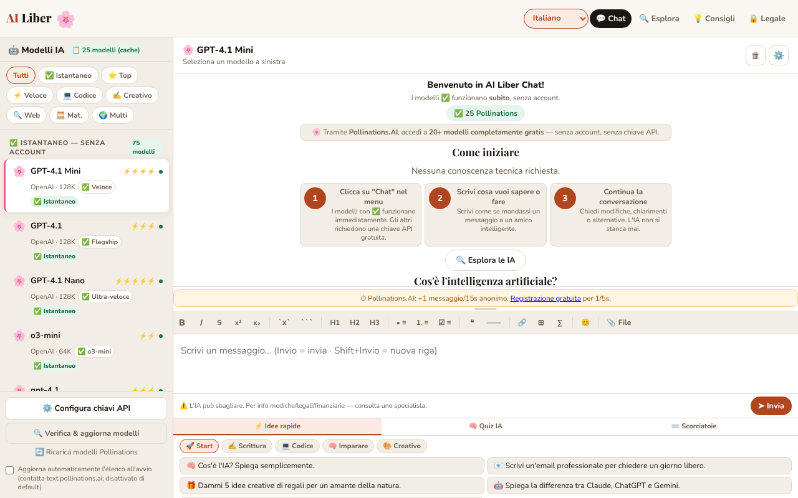

# AI Liber — L'intelligenza artificiale per tutti

[English](README.md) · [Română](README.ro.md) · [Français](README.fr.md) · **Italiano** · [Español](README.es.md) · [Português](README.pt.md) · [Deutsch](README.de.md) · [Magyar](README.hu.md)

**Versione:** 1.4.8 · **Ultimo aggiornamento:** 2026-10-23

Lingue dell'interfaccia: **Română, English, Français, Italiano, Español, Português (PT), Deutsch, Magyar**

Chatta con modelli di intelligenza artificiale gratuiti o con le tue chiavi API, più una guida alle migliori IA gratuite, in un unico file HTML.

**Applicazione online:** https://chiuta.github.io/AI-Liber/

## Che cos'è

AI Liber è un'applicazione in un unico file (`index.html`) che offre un'unica interfaccia di chat verso più provider di modelli linguistici: servizi gratuiti senza account (ad esempio Pollinations, DuckDuckGo AI Chat, AI Horde), servizi con chiave API propria (OpenAI, Anthropic, Gemini, Groq, Mistral, OpenRouter, Perplexity), server locali (Ollama, LM Studio) e un modello eseguito direttamente nel browser tramite WebLLM. Include anche una sezione con un catalogo di IA gratuite, un quiz e idee di prompt.

## Funzioni

- Chat con selettore di modello/provider, invio con il pulsante «➤ Invia», interruzione di una richiesta in corso.
- Barra di formattazione Markdown (grassetto, corsivo, barrato, codice, elenco, citazione, tabella ecc.).
- Pannello «Configura le chiavi API» per i provider che richiedono una chiave; le chiavi vengono conservate in locale, offuscate con AES-GCM (l'applicazione avverte esplicitamente che non si tratta di una cifratura robusta).
- Pulsante «Verifica & aggiorna i modelli» per aggiornare l'elenco dei modelli.
- Supporto per i server locali Ollama (`localhost:11434`) e LM Studio (`localhost:1234`) e per un modello locale nel browser (WebLLM).
- Catalogo «Le migliori IA gratuite», filtrabile per categorie (Chat, Ricerca, Immagini, Video IA, Media, Codice, Scrittura, Produttività, Creativo) e per «Senza account» / «Locale (browser)».
- Pannello inferiore con «⚡ Idee rapide» (prompt), «🧠 Quiz IA» e «⌨️ Scorciatoie».
- Interfaccia in 8 lingue: rumeno, inglese, francese, tedesco, spagnolo, portoghese, italiano, ungherese.
- Testi sulla riservatezza (GDPR), termini e informazioni sui cookie/archiviazione locale, in ogni lingua.

## Funzioni per la privacy (dalla 1.1.0)

- **Verifica locale dei dati personali prima dell'invio** (`FFF.pii`): quando il messaggio sta per partire verso un servizio esterno (Pollinations, DuckDuckGo, AI Horde, API con chiave), l'applicazione cerca in locale e-mail, telefoni, IBAN (mod 97), CNP (cifra di controllo), carte (Luhn), IP, chiavi/token. Se trova qualcosa, non invia nulla finché non scegli: «Maschera le voci selezionate e continua», «Continua senza mascherare» o «Annulla» (il testo resta nel campo). Si può disattivare dalla barra laterale (la preferenza viene conservata). Per i modelli locali (WebLLM, Ollama, LM Studio) la finestra di dialogo non viene mostrata, perché il testo non lascia il computer.
- **Indicatore «cosa lascia questo dispositivo»** accanto al selettore del modello: «Locale: i messaggi restano nel browser» (WebLLM), «Locale: i messaggi vanno solo al server di questo computer» (Ollama/LM Studio) o «I messaggi partono verso <host>» (servizi esterni). Per WebLLM, l'indicatore precisa che i file del modello vengono scaricati dalla rete al primo utilizzo, ma il tuo testo non parte.
- **Cronologia locale delle conversazioni, facoltativa (disattivata per impostazione predefinita):** se selezioni «Salva le conversazioni su questo dispositivo», le conversazioni vengono conservate in `localStorage` (chiavi `ailib_conv`, `ailib_hist`), con i dati personali mascherati se vuoi (pulsante «Cerca dati personali nella cronologia»). Il pannello «🗂 Cronologia locale» offre ricerca locale per significato (`FFF.search`: BM25, segni diacritici, forme simili, frammenti evidenziati), ripresa di una conversazione nella chat, eliminazione per conversazione, esportazione Markdown.
- **Copia cifrata della cronologia** tramite l'etichetta di trasparenza (Esporta cifrato, password). Le chiavi API e il segreto di sessione **non** entrano nella copia (verificato con un test).

### Limiti
- Il rilevamento dei dati personali è euristico (nomi propri e indirizzi hanno bassa affidabilità). Non garantisce l'assenza di dati sensibili.
- La mascheratura si applica al testo nel campo del messaggio, non ai file già caricati nella chat.
- La cronologia ha un limite di dimensione; al superamento vengono eliminate le conversazioni più vecchie (con un messaggio).

**Kit FFF.** Dal `fff-kit` (incollato in `index.html`, senza rete) si usano i moduli `core, label, bundle, pii, search`: etichetta di trasparenza (premi la versione nel piè di pagina), esportazione/importazione/cancellazione `.fff.json` con cifratura facoltativa AES-GCM + PBKDF2, rilevamento locale dei dati personali e ricerca locale BM25. La politica CSP **non è stata modificata** rispetto alla versione precedente, a parte gli hash `sha256` degli script inline (i nuovi stili sono in `<style>`, coperto dallo `style-src 'unsafe-inline'` già presente; non è stato aggiunto alcun nuovo host). Le traduzioni dei nuovi testi in fr/it/es/pt/hu/de sono automatiche e **non verificate da madrelingua**. Il rilevamento dei dati personali è euristico: può non rilevare o segnalare erroneamente; non sostituisce la tua verifica.

## Guida all'uso

1. Apri l'applicazione e scegli la lingua dal selettore di lingua (Română, English, Français, Deutsch, Español, Português, Italiano, Magyar).
2. Scegli un modello dall'elenco. I modelli contrassegnati «Senza account» non richiedono una chiave.
3. Per un provider con chiave: premi «⚙️ Configura le chiavi API», inserisci la chiave per il provider desiderato e chiudi la finestra.
4. Scrivi il messaggio nel campo di testo e premi Invio o «➤ Invia». Maiusc+Invio inserisce una nuova riga.
5. Formattazione: Ctrl+B (grassetto), Ctrl+I (corsivo), Ctrl+Z (annulla); Esc chiude le finestre; ↑↓ scorrono l'elenco dei modelli.
6. Per i modelli locali: avvia Ollama con `OLLAMA_ORIGINS=* ollama serve` o il server LM Studio sulla porta 1234, poi scegli il modello locale.
7. Usa «⚡ Idee rapide», «🧠 Quiz IA» o la sezione «Le migliori IA gratuite» per ispirarti e scoprire servizi.
8. Per eliminare i dati, usa le opzioni descritte nella finestra sulla riservatezza oppure svuota i dati del sito nel browser.

## Riservatezza e rete

L'applicazione **non è strettamente offline**: la chat funziona solo contattando i servizi che scegli.

- **Persistenza delle chiavi API:** le chiavi vengono cifrate (AES-GCM) con un segreto casuale conservato in `sessionStorage`; in pratica sopravvivono al ricaricamento della stessa scheda, ma **non a una nuova scheda né al riavvio del browser** (il segreto si perde, le chiavi cifrate restano illeggibili in `localStorage`), quindi vanno reinserite. Verificato con un test (ricaricamento: la chiave resta; nuova scheda: vuoto).
- **Archiviazione locale (localStorage):** la lingua (`ailib_lang`), le chiavi API offuscate (`aik_enc_*`, `aik_*`) con un sale (`ailib_ksalt`), un elenco locale dei modelli che hanno restituito un errore 404 (`ailib_404`), una preferenza di interfaccia (`ailib_sbw`), l'opzione di aggiornamento automatico dell'elenco dei modelli (`ailib_pollauto`, solo se la selezioni). In `sessionStorage`: un segreto di sessione (`ailib_ssec`). Inoltre la preferenza per la verifica dei dati personali (`ailib_piiguard`) e, solo se spunti l'opzione, la cronologia locale (`ailib_hist`, `ailib_conv`).
- **Al caricamento della pagina:** non viene inviata alcuna richiesta automatica a Pollinations. L'elenco in tempo reale dei modelli (`https://text.pollinations.ai/models`) viene richiesto solo se premi «Ricarica i modelli Pollinations» / «Verifica & aggiorna i modelli» o se selezioni esplicitamente, nella barra laterale, «Aggiorna automaticamente l'elenco all'avvio» (opt-in, disattivato per impostazione predefinita; la preferenza viene conservata in `ailib_pollauto`). Fino ad allora si usa il catalogo locale nella pagina. Quando una risposta contiene formule (`$…$`), KaTeX viene caricato da `vendor/` (stessa origine, con verifica di integrità SRI).
- **Host di terze parti contattati, solo dopo un'azione da parte tua (invio di un messaggio, ricaricamento dell'elenco, attivazione di WebLLM):** `text.pollinations.ai`, `auth.pollinations.ai` (Pollinations); `duckduckgo.com` (DuckDuckGo AI Chat); `aihorde.net` (AI Horde); `api.openai.com`, `api.anthropic.com`, `generativelanguage.googleapis.com`, `api.perplexity.ai` e altre API dei provider, solo se usi la rispettiva chiave; `raw.githubusercontent.com/mlc-ai/binary-mlc-llm-libs/00fe7a40e57e5e8eb9fef87526a4bf28ad5846c0/` (la libreria del modello `.wasm`, commit fissato, verificata da WebLLM con SRI SHA-256; solo quando attivi il modello nel browser) e `huggingface.co/mlc-ai/` (+ `*.huggingface.co`, `*.hf.co`) per i pesi, che non hanno un hash fissato. WebLLM stesso (`@mlc-ai/web-llm@0.2.84`) è in `vendor/`, non su una CDN. A seconda del modello, lo scaricamento dei pesi dagli host di WebLLM.
- I tuoi messaggi vengono inviati al provider scelto; si applicano le sue politiche. Le chiavi vengono inviate solo al provider a cui appartengono.
- I file caricati nella chat vengono elaborati in locale nel browser (`vendor/mammoth.browser.min.js` per .docx, `vendor/pdfjs/` per PDF), ma il testo estratto arriva al provider scelto insieme al messaggio. I cataloghi contengono link esterni (solo navigazione, al clic).
- **CSP:** lo script inline è consentito solo tramite hash `sha256` (senza `'unsafe-inline'` in `script-src`); gli eventi dell'interfaccia sono gestiti da un dispatcher delegato (`data-onclick`, `data-onchange`, `data-oninput`, `data-onkeydown` + `data-arg`), senza attributi `on*` inline. **Dopo qualsiasi modifica dello script, ricalcola l'hash nel meta CSP.** `script-src` consente solo `'self'` (più l'hash dello script inline): WebLLM, KaTeX, pdf.js e mammoth sono caricati da `vendor/`; nessun host di CDN è consentito. Vedi `NOTICE.md`.
- I server locali (`localhost`) vengono contattati solo se li selezioni; da pagine HTTPS il browser può bloccare le chiamate verso `http://localhost` (contenuto misto).

## Limitazioni

Le risposte dell'IA possono essere sbagliate; l'applicazione mostra sotto il campo del messaggio l'avvertimento «AI can make mistakes. For medical/legal/financial info — consult a specialist» (nella lingua dell'interfaccia). I messaggi vengono elaborati dai provider scelti, secondo le loro politiche.

## Esecuzione locale / offline

Scarica `index.html` e aprilo in un browser. L'interfaccia, il catalogo, il quiz e le guide funzionano senza internet; per qualsiasi risposta della chat serve una connessione al provider scelto (oppure un server locale Ollama/LM Studio avviato sul tuo computer).

## Licenza

MIT — vedi il file LICENSE

## Audit

Audit: 2026-10-10 (round 2: 2026-10-11) — `fetchPollModels()` è ora opt-in (non viene più eseguito all'avvio o su `visibilitychange` senza il tuo consenso); il messaggio nell'interfaccia sulle chiavi dice esplicitamente che durano solo per la sessione della scheda; KaTeX da cdn.jsdelivr.net (index.html:~7063). La resa Markdown delle risposte dell'IA è protetta contro l'XSS (testato con ``, `javascript:`, attributi iniettati in href, formule). Correzioni di contrasto e focus.

## Autore

Alexio — Alexandru-Ionuț Chiuță, contatto: alexio@trom.tf. L'applicazione è offerta nello spirito del movimento trade-free TROM (trom.tf); il sostegno volontario è facoltativo.

## Riepilogo

AI Liber è un front-end di chat HTML in un unico file per servizi di IA gratuiti senza account, API con chiave propria, server locali Ollama/LM Studio e un modello WebLLM nel browser, più un elenco di strumenti di IA gratuiti, un quiz e idee di prompt. Interfaccia in 8 lingue. Le chiavi sono conservate in localStorage (offuscate con AES-GCM, non una cifratura robusta). La chat richiede l'accesso a internet verso il provider scelto. Licenza MIT.

## Fonti verificate l'11.10.2026
- DuckDuckGo AI Chat (duck.ai), modelli gratuiti senza account: TechRadar, «Duck.ai by DuckDuckGo review», 13 luglio 2026 (https://techradar.com/pro/duck-ai-review): Claude 4.5 Haiku, GPT-4o mini, GPT-5 mini, gpt-oss-120b, Llama 4 Scout, Mistral Small 3 24B. I modelli codificati nell'applicazione per DuckDuckGo (Claude 3 Haiku, Llama 3.1 70B, Mixtral 8x7B, o3-mini) potrebbero essere ritirati; gli ID API di DuckDuckGo non possono essere verificati senza rete e non sono stati modificati (l'applicazione ha «Verifica & aggiorna i modelli» e l'elenco dei modelli che danno 404).
- Pollinations (testo, senza chiave, ~1 richiesta/15 s in forma anonima, chiave gratuita facoltativa): https://free-llm.com/provider/pollinations-ai (pagina aggiornata a ottobre 2026).
- I testi legali (versione «v1.0 · 12 aprile 2026») non sono stati modificati in questo round; la loro data è una decisione dell'autore e non è stata cambiata.

## Cronologia / Changelog

### 1.4.7 — 2026-10-22
- Il caricamento delle librerie non si fida più di una CDN: WebLLM 0.2.84 (e KaTeX 0.16.9) sono in `vendor/` e caricati dalla stessa origine; le librerie dei modelli (`.wasm`) provengono da un commit fissato di `binary-mlc-llm-libs` e sono verificate con SRI SHA-256 (rifiutate in caso di differenza). La CSP non consente più `esm.run`, `cdn.jsdelivr.net` né tutto `raw.githubusercontent.com`.
- Gli id dei modelli Gemma 2 ora corrispondono a WebLLM 0.2.84 (`gemma-2-*-it-q4f16_1-MLC`). Nuovo `NOTICE.md`. Dimensione aggiunta: ~6,4 MB.

- 1.4.6 — 2026-10-22: fff-kit 1.1.4: target touch e dimensione minima del testo
- 1.4.5 — 2026-10-22: fff-kit 1.1.2: PBKDF2 600.000 iterazioni, protezione anti-clickjacking
- 1.4.4 — 2026-10-22: Finestra di consenso prima del primo messaggio verso un servizio esterno senza chiave (Pollinations, DuckDuckGo, AI Horde); la conferma di rimozione dei modelli usa una finestra integrata invece di window.confirm; testo ≥ 12 px e caselle più grandi su mobile.

- 1.4.3 — 2026-10-22: **correzione**: i nomi di AI Horde e dei modelli locali (LM Studio, Ollama) e la scheda AI Horde nella griglia di esplorazione seguono ora la lingua scelta.
- **1.4.2 (22 ottobre 2026):** Il titolo della pagina segue ora la lingua dell'interfaccia; le etichette dell'elenco dei modelli e il catalogo Explore vengono ricostruiti all'avvio nella lingua salvata (dopo un ricaricamento restavano in rumeno); il testo della finestra di verifica dei modelli è tradotto.
- **1.4.1 — 2026-10-19:** la verifica dei dati personali prima dell'invio, l'indicatore «cosa parte» e la cronologia locale facoltativa descritti sopra (introdotti nella 1.1.0) sono presenti nella versione attuale: erano stati rimossi per errore in una pulizia precedente e sono stati reimplementati con lo stesso comportamento e nuovi test (`tests/fff-r8.test.mjs`). L'interfaccia (comprese le descrizioni dei modelli) è disponibile in 8 lingue, ungherese incluso.
- **1.1.0 — 2026-10-14:** verifica locale dei dati personali prima dell'invio (`FFF.pii`), indicatore «cosa parte», cronologia locale facoltativa con ricerca (`FFF.search`), copia cifrata `.fff.json` (`FFF.bundle`), etichetta di trasparenza; test in `tests/fff-r8.test.mjs`.
- 1.0.0 — 2026-10-12: la versione e la data dell'ultimo aggiornamento sono mostrate nell'applicazione
- **11 ottobre 2026 (round 7)** — nel pannello delle chiavi API la nota di sicurezza non mostra più letteralmente `<strong>NOT</strong>` (i tag HTML sono stati rimossi dal testo nelle 7 lingue); l'intestazione «🤖 Modelli IA» del pannello laterale e i badge «N modelli (cache/live)» si traducono ora al cambio di lingua; le etichette delle specifiche dei modelli («Il più veloce», «Ragionamento», «Programmazione» ecc.) sono tradotte in EN/FR/IT/ES/PT/DE; le guide dei provider nelle Impostazioni compaiono in inglese (non in rumeno) nelle lingue diverse dal RO; la CSP mantiene l'hash ricalcolato. I testi legali non sono stati modificati. 0 errori, axe 0 violazioni a 1280×800 e 360×740.
- **11 ottobre 2026 (secondo intervento)** — i 112 attributi `on*` inline (85 gestori distinti) sono stati sostituiti da un dispatcher delegato a livello di `body`, e la CSP non ha più `'unsafe-inline'` in `script-src` (hash `sha256`); la parità di comportamento è stata verificata automaticamente su 12 stati dell'applicazione (oltre 6.800 eventi innescati sulla versione vecchia e su quella nuova, stesse chiamate e stessi argomenti, 0 differenze) e con la CSP attiva (0 errori, 0 violazioni). Il catalogo dei modelli viene ora ricostruito al cambio di lingua (le etichette «gira nel browser», «Locale nel browser», i gruppi di ragionamento non restano più nella lingua precedente), le guide dei provider nelle Impostazioni hanno una traduzione in inglese (nelle altre lingue restano in rumeno), l'etichetta e le aria-label del widget di sostegno sono tradotte nelle 7 lingue, e le offerte di crediti di prova nelle guide OpenAI/Anthropic sono formulate come variabili («verifica sul sito»), non come promesse.
- **11 ottobre 2026** — la schermata di benvenuto viene rigenerata al cambio di lingua (prima restava in rumeno in un'interfaccia inglese/francese ecc.); il banner non elenca più modelli deperibili (GPT-4, Llama 70B, DeepSeek R1…); la guida DuckDuckGo è datata e con avvertimento sui modelli ritirati; nota datata in «Esplora» sui piani gratuiti mutevoli; messaggio chiaro «sei offline» (7 lingue) al posto di un errore di rete quando scegli un modello che richiede internet; a 360 px non ci sono più overflow orizzontali (barra superiore, pagina Legale).
- Accessibilità: il contenuto è in `main` (compresa la pagina Legale), titolo `h1` nascosto visivamente, ordine dei titoli corretto, il widget di sostegno ha il ruolo `complementary`; axe-core: 0 violazioni a 1280×800 e 360×740 sulle pagine Chat, Esplora, Consigli e Legale. I 113 attributi `onclick`/`onchange` inline sono rimasti (la CSP consente `'unsafe-inline'`; rifattorizzarli sarebbe rischioso senza test di regressione estesi). L'applicazione non ha un numero di versione.
