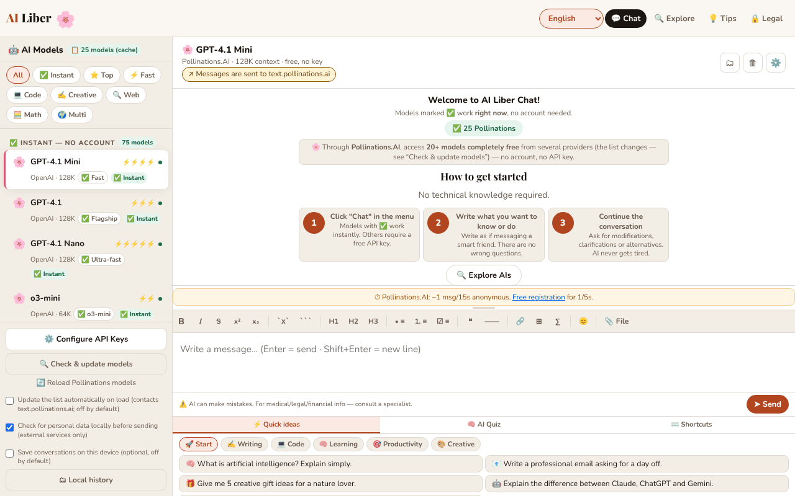

# AI Liber — Artificial intelligence for everyone

**English** · [Română](README.ro.md) · [Français](README.fr.md) · [Italiano](README.it.md) · [Español](README.es.md) · [Português](README.pt.md) · [Deutsch](README.de.md) · [Magyar](README.hu.md)

**Version:** 1.4.5 · **Last updated:** 2026-10-22

Interface languages: **Română, English, Français, Italiano, Español, Português (PT), Deutsch, Magyar**

Chat with free artificial-intelligence models or with your own API keys, plus a guide to the best free AIs, in a single HTML file.

**Live app:** https://chiuta.github.io/AI-Liber/

## What it is

AI Liber is a single-file app (`index.html`) that offers one chat interface to several language-model providers: free services with no account (for example Pollinations, DuckDuckGo AI Chat, AI Horde), services with your own API key (OpenAI, Anthropic, Gemini, Groq, Mistral, OpenRouter, Perplexity), local servers (Ollama, LM Studio) and a model run directly in the browser through WebLLM. It also includes a section with a catalogue of free AIs, a quiz and prompt ideas.

## Features

- Chat with a model/provider selector, sending with the "➤ Send" button, stopping a request in progress.
- A Markdown formatting bar (bold, italic, strikethrough, code, list, quote, table, etc.).
- A "Configure API keys" panel for the providers that require a key; the keys are kept locally, obscured with AES-GCM (the app explicitly warns that this is not strong encryption).
- A "Check & update models" button to refresh the model list.
- Support for local Ollama servers (`localhost:11434`) and LM Studio (`localhost:1234`) and for a local in-browser model (WebLLM).
- A "Best free AIs" catalogue, filterable by category (Chat, Research, Images, AI Video, Media, Code, Writing, Productivity, Creative) and by "No account" / "Local (browser)".
- A bottom panel with "⚡ Quick ideas" (prompts), "🧠 AI Quiz" and "⌨️ Shortcuts".
- Interface in 8 languages: Romanian, English, French, German, Spanish, Portuguese, Italian, Hungarian.
- Privacy texts (GDPR), terms and information about cookies/local storage, in every language.

## Privacy features (since 1.1.0)

- **Local check for personal data before sending** (`FFF.pii`): when the message is about to go to an external service (Pollinations, DuckDuckGo, AI Horde, API-key services), the app looks locally for emails, phone numbers, IBANs (mod 97), CNPs (check digit), cards (Luhn), IPs, keys/tokens. If it finds something, it sends nothing until you choose: "Mask the ticked items and continue", "Continue without masking" or "Cancel" (the text stays in the field). It can be switched off from the sidebar (the preference is kept). For local models (WebLLM, Ollama, LM Studio) the dialog is not shown, because the text does not leave the computer.
- **"What leaves this device" indicator** next to the model selector: "Local: messages stay in the browser" (WebLLM), "Local: messages go only to the server on this computer" (Ollama/LM Studio) or "Messages go to <host>" (external services). For WebLLM, the indicator specifies that the model files are downloaded from the network on first use, but your text does not leave.
- **Optional local conversation history (off by default):** if you tick "Save conversations on this device", conversations are kept in `localStorage` (keys `ailib_conv`, `ailib_hist`), with personal data masked if you want (button "Search for personal data in the history"). The "🗂 Local history" panel has local search by meaning (`FFF.search`: BM25, diacritics, close forms, highlighted fragments), resuming a conversation in the chat, deletion per conversation, Markdown export.
- **Encrypted copy of the history** through the transparency label (Export encrypted, password). The API keys and the session secret are **not** included in the copy (verified in a test).

### Limits
- Personal-data detection is heuristic (proper names and addresses have low confidence). It does not guarantee the absence of sensitive data.
- Masking applies to the text in the message field, not to files already uploaded to the chat.
- The history has a size cap; when it is exceeded, the oldest conversations are removed (with a message).

**FFF kit.** From `fff-kit` (pasted into `index.html`, no network) the modules `core, label, bundle, pii, search` are used: the transparency label (press the version in the footer), `.fff.json` export/import/deletion with optional AES-GCM + PBKDF2 encryption, local personal-data detection and local BM25 search. The CSP policy **has not been changed** from the previous version apart from the `sha256` hashes of the inline scripts (the new styles are in `<style>`, covered by the `style-src 'unsafe-inline'` already present; no new host was added). The translations of the new texts into fr/it/es/pt/hu/de are automatic and **not natively verified**. Personal-data detection is heuristic: it may miss or wrongly flag; it does not replace your own checking.

## User guide

1. Open the app and choose the language from the language selector (Romanian, English, Français, Deutsch, Español, Português, Italiano, Magyar).
2. Choose a model from the list. Models marked "No account" do not require a key.
3. For a provider with a key: press "⚙️ Configure API keys", enter the key for the provider you want and close the window.
4. Write the message in the text field and press Enter or "➤ Send". Shift+Enter inserts a new line.
5. Formatting: Ctrl+B (bold), Ctrl+I (italic), Ctrl+Z (undo); Esc closes the windows; ↑↓ navigate the model list.
6. For local models: start Ollama with `OLLAMA_ORIGINS=* ollama serve` or the LM Studio server on port 1234, then choose the local model.
7. Use "⚡ Quick ideas", "🧠 AI Quiz" or the "Best free AIs" section for inspiration and for discovering services.
8. To delete the data, use the options described in the privacy window or clear the site's data in the browser.

## Privacy and network

The app **is not strictly offline**: the chat works only by contacting the services you choose.

- **API-key persistence:** the keys are encrypted (AES-GCM) with a random secret kept in `sessionStorage`; in practice they survive a reload of the same tab, but **not a new tab or a browser restart** (the secret is lost, the encrypted keys remain unreadable in `localStorage`), so they have to be re-entered. Verified by a test (reload: the key stays; new tab: empty).
- **Local storage (localStorage):** the language (`ailib_lang`), obscured API keys (`aik_enc_*`, `aik_*`) with a salt (`ailib_ksalt`), a local list of models that returned a 404 error (`ailib_404`), an interface preference (`ailib_sbw`), the option to automatically update the model list (`ailib_pollauto`, only if you tick it). In `sessionStorage`: a session secret (`ailib_ssec`). Also: the personal-data check preference (`ailib_piiguard`) and, only if you tick the option, the local history (`ailib_hist`, `ailib_conv`).
- **On page load:** no automatic request is sent to Pollinations. The live model list (`https://text.pollinations.ai/models`) is requested only if you press "Reload Pollinations models" / "Check & update models" or explicitly tick, in the sidebar, "Automatically update the list at startup" (opt-in, off by default; the preference is kept in `ailib_pollauto`). Until then the local catalogue in the page is used. When an answer contains formulas (`$…$`), KaTeX is loaded from `cdn.jsdelivr.net` (pinned version, with SRI integrity check).
- **Third-party hosts contacted, only after an action of yours (sending a message, reloading the list, enabling WebLLM):** `text.pollinations.ai`, `auth.pollinations.ai` (Pollinations); `duckduckgo.com` (DuckDuckGo AI Chat); `aihorde.net` (AI Horde); `api.openai.com`, `api.anthropic.com`, `generativelanguage.googleapis.com`, `api.perplexity.ai` and other providers' APIs, only if you use the respective key; `esm.run` (loading WebLLM `@mlc-ai/web-llm@0.2.84`, only when you enable the in-browser model) and, depending on the model, the download of the weights from the WebLLM hosts.
- Your messages are sent to the chosen provider; their policies apply. The keys are sent only to the provider they belong to.
- Files uploaded to the chat are processed locally in the browser (`vendor/mammoth.browser.min.js` for .docx, `vendor/pdfjs/` for PDF), but the extracted text reaches the chosen provider along with the message. The catalogues contain external links (navigation only, on click).
- **CSP:** the inline script is allowed only by `sha256` hash (no `'unsafe-inline'` in `script-src`); UI events are handled by a delegated dispatcher (`data-onclick`, `data-onchange`, `data-oninput`, `data-onkeydown` + `data-arg`), with no inline `on*` attributes. **After any change to the script, recalculate the hash in the CSP meta.** The hosts allowed in `script-src` (`esm.run`, `cdn.jsdelivr.net`) remain for WebLLM and KaTeX, loaded only on your action.
- Local servers (`localhost`) are contacted only if you select them; from HTTPS pages the browser may block calls to `http://localhost` (mixed content).

## Limitations

AI answers can be wrong; the app displays under the message field the warning "AI can make mistakes. For medical/legal/financial info — consult a specialist" (in the interface language). Messages are processed by the chosen providers, according to their policies.

## Running locally / offline

Download `index.html` and open it in a browser. The interface, the catalogue, the quiz and the guides work without internet; for any chat answer you need a connection to the chosen provider (or a local Ollama/LM Studio server running on your computer).

## Licence

MIT — see the LICENSE file

## Audit

Audit: 2026-10-10 (round 2: 2026-10-11) — `fetchPollModels()` is now opt-in (it no longer runs at startup or on `visibilitychange` without your consent); the message in the interface about keys explicitly says they last only for the tab's session; KaTeX from cdn.jsdelivr.net (index.html:~7063). The Markdown rendering of AI answers is protected against XSS (tested with ``, `javascript:`, injected attributes in href, formulas). Contrast and focus fixes.

## Author

Alexio — Alexandru-Ionuț Chiuță, contact: alexio@trom.tf. The app is offered in the spirit of the trade-free TROM movement (trom.tf); voluntary support is optional.

## Summary

AI Liber is a single-file HTML chat front-end for free no-account AI services, bring-your-own-key APIs, local Ollama/LM Studio servers and an in-browser WebLLM model, plus a directory of free AI tools, a quiz and prompt ideas. 8 UI languages. Keys are kept in localStorage (AES-GCM obfuscated, not strong encryption). Chat requires internet access to the chosen provider. MIT licence.

## Sources verified on 11.10.2026
- DuckDuckGo AI Chat (duck.ai), free models with no account: TechRadar, "Duck.ai by DuckDuckGo review", 13 July 2026 (https://techradar.com/pro/duck-ai-review): Claude 4.5 Haiku, GPT-4o mini, GPT-5 mini, gpt-oss-120b, Llama 4 Scout, Mistral Small 3 24B. The models hard-coded in the app for DuckDuckGo (Claude 3 Haiku, Llama 3.1 70B, Mixtral 8x7B, o3-mini) may be retired; DuckDuckGo's API IDs cannot be verified without a network and were not changed (the app has "Check & update models" and the list of models that return 404).
- Pollinations (text, no key, ~1 request/15 s anonymous, optional free key): https://free-llm.com/provider/pollinations-ai (page updated in October 2026).
- The legal texts (version "v1.0 · 12 April 2026") were not modified in this round; their date is the author's decision and was not changed.

## History / Changelog

- 1.4.5 — 2026-10-22: fff-kit 1.1.2: PBKDF2 600,000 iterations, anti-clickjacking protection
- 1.4.4 — 2026-10-22: Consent dialog before the first message to an external keyless service (Pollinations, DuckDuckGo, AI Horde); the model-removal confirmation uses an in-page dialog instead of window.confirm; text ≥ 12 px and larger checkboxes on mobile.

- 1.4.3 — 2026-10-22: **fix**: the AI Horde and local-model names (LM Studio, Ollama) and the AI Horde card in the explore grid now follow the selected language.
- **1.4.2 (22 October 2026):** The page title now follows the interface language; the model list labels and the Explore catalog are rebuilt in the saved language at startup (they used to stay Romanian after a reload); the model-check dialog text is translated.
- **1.4.1 — 2026-10-19:** the personal-data check before sending, the "what leaves" indicator and the optional local history described above (introduced in 1.1.0) are present in the current version: they had been removed by mistake in an earlier cleanup and were reimplemented with the same behaviour and new tests (`tests/fff-r8.test.mjs`). The interface (including the descriptions of the models) is available in 8 languages, Hungarian included.
- **1.1.0 — 2026-10-14:** local check for personal data before sending (`FFF.pii`), "what leaves" indicator, optional searchable local history (`FFF.search`), encrypted `.fff.json` copy (`FFF.bundle`), transparency label; tests in `tests/fff-r8.test.mjs`.
- 1.0.0 — 2026-10-12: the version and the date of the last update are shown in the app
- **11 October 2026 (round 7)** — in the API-keys panel the security note no longer displays the literal `<strong>NOT</strong>` (the HTML tags were removed from the text in the 7 languages); the "🤖 AI Models" header in the side panel and the "N models (cache/live)" badges are now translated when the language changes; the models' specification labels ("Fastest", "Reasoning", "Programming", etc.) are translated into EN/FR/IT/ES/PT/DE; the providers' guides in Settings appear in English (not in Romanian) in the non-RO languages; the CSP keeps the recalculated hash. The legal texts were not modified. 0 errors, axe 0 violations at 1280×800 and 360×740.
- **11 October 2026 (second intervention)** — the 112 inline `on*` attributes (85 distinct handlers) were replaced with a delegated dispatcher at `body` level, and the CSP no longer has `'unsafe-inline'` in `script-src` (`sha256` hash); behavioural parity was verified automatically on 12 states of the app (over 6,800 events fired on the old and the new version, the same calls and arguments, 0 differences) and with CSP active (0 errors, 0 violations). The model catalogue is now rebuilt when the language changes (the labels "runs in the browser", "Local in browser", the reasoning groups no longer stay in the old language), the providers' guides in Settings have an English translation (in the other languages they remain in Romanian), the label and the aria-labels of the support widget are translated into the 7 languages, and the trial-credit offers in the OpenAI/Anthropic guides are worded as variables ("check the site"), not as promises.
- **11 October 2026** — the welcome screen is regenerated when the language changes (before, it stayed in Romanian in an English/French etc. interface); the banner no longer lists perishable models (GPT-4, Llama 70B, DeepSeek R1…); the DuckDuckGo guide is dated and carries a warning about retired models; a dated note in "Explore" about changing free plans; a clear "you are offline" message (7 languages) instead of a network error when you choose a model that needs internet; on 360 px there are no more horizontal overflows (top bar, Legal page).
- Accessibility: the content is in `main` (including the Legal page), a visually hidden `h1` heading, the heading order corrected, the support widget has the `complementary` role; axe-core: 0 violations at 1280×800 and 360×740 on the Chat, Explore, Tips and Legal pages. The 113 inline `onclick`/`onchange` attributes remained (the CSP allows `'unsafe-inline'`; refactoring them would be risky without extensive regression tests). The app has no version number.
