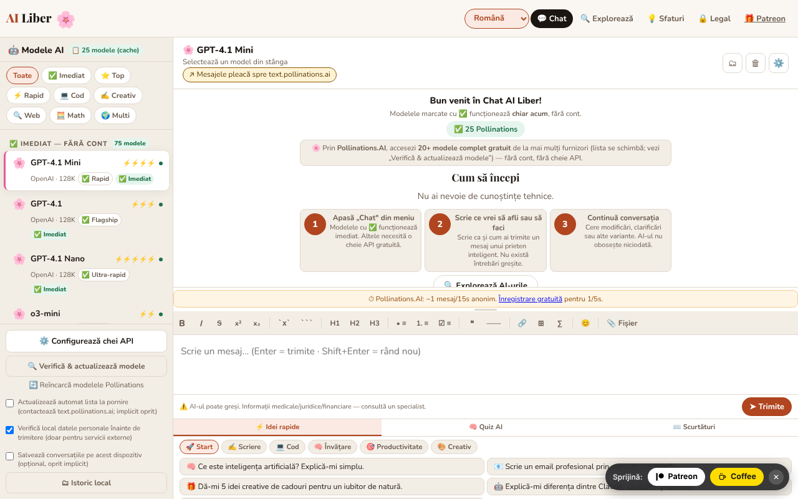

# AI Liber — Inteligența artificială pentru toți

Chat cu modele de inteligență artificială gratuite sau cu cheile tale API, plus un ghid al celor mai bune AI-uri gratuite, într-un singur fișier HTML.

**Ultima actualizare:** 11 octombrie 2026

**Live:** https://chiuta.github.io/AI-Liber/

## Ce este

AI Liber este o aplicație single-file (`index.html`) care oferă o interfață unică de chat către mai mulți furnizori de modele de limbaj: servicii gratuite, fără cont (de exemplu Pollinations, DuckDuckGo AI Chat, AI Horde), servicii cu cheie API proprie (OpenAI, Anthropic, Gemini, Groq, Mistral, OpenRouter, Perplexity), servere locale (Ollama, LM Studio) și un model rulat direct în browser prin WebLLM. Include și o secțiune cu un catalog de AI-uri gratuite, un quiz și idei de prompturi.

## Funcții

- Chat cu selector de model/furnizor, trimitere cu butonul „➤ Trimite”, oprirea unei cereri în curs.
- Bară de formatare Markdown (aldin, cursiv, tăiat, cod, listă, citat, tabel etc.).
- Panou „Configurează chei API” pentru furnizorii care cer cheie; cheile sunt păstrate local, obscurizate cu AES-GCM (aplicația avertizează explicit că aceasta nu este criptare robustă).
- Buton „Verifică & actualizează modele” pentru reîmprospătarea listei de modele.
- Suport pentru servere locale Ollama (`localhost:11434`) și LM Studio (`localhost:1234`) și pentru un model local în browser (WebLLM).
- Catalog „Cele mai bune AI-uri gratuite”, filtrabil pe categorii (Chat, Cercetare, Imagini, Video AI, Media, Cod, Scriere, Productivitate, Creativ) și pe „Fără cont” / „Local (browser)”.
- Panou inferior cu „⚡ Idei rapide” (prompturi), „🧠 Quiz AI” și „⌨️ Shortcuts”.
- Interfață în 7 limbi: română, engleză, franceză, germană, spaniolă, portugheză, italiană.
- Texte de confidențialitate (GDPR), termeni și informații despre cookie-uri/stocare locală, în fiecare limbă.

## Manual de utilizare

1. Deschide aplicația și alege limba din selectorul de limbă (Română, English, Français, Deutsch, Español, Português, Italiano).
2. Alege un model din listă. Modelele marcate „Fără cont” nu cer cheie.
3. Pentru un furnizor cu cheie: apasă „⚙️ Configurează chei API”, introdu cheia pentru furnizorul dorit și închide fereastra.
4. Scrie mesajul în câmpul de text și apasă Enter sau „➤ Trimite”. Shift+Enter inserează un rând nou.
5. Formatare: Ctrl+B (aldin), Ctrl+I (cursiv), Ctrl+Z (anulare); Esc închide ferestrele; ↑↓ navighează lista de modele.
6. Pentru modele locale: pornește Ollama cu `OLLAMA_ORIGINS=* ollama serve` sau serverul LM Studio pe portul 1234, apoi alege modelul local.
7. Folosește „⚡ Idei rapide”, „🧠 Quiz AI” sau secțiunea „Cele mai bune AI-uri gratuite” pentru inspirație și descoperire de servicii.
8. Pentru a șterge datele, folosește opțiunile descrise în fereastra de confidențialitate sau golește datele site-ului din browser.

## Confidențialitate și rețea

Aplicația **nu este strict offline**: chatul funcționează doar prin contactarea serviciilor alese de tine.

- **Persistența cheilor API:** cheile se criptează (AES-GCM) cu un secret aleator păstrat în `sessionStorage`; în practică ele supraviețuiesc reîncărcării aceleiași file, dar **nu și unei file noi sau repornirii browserului** (secretul se pierde, cheile cifrate rămân nereadabile în `localStorage`), deci trebuie reintroduse. Verificat prin test (reîncărcare: cheia rămâne; filă nouă: gol).
- **Stocare locală (localStorage):** limba (`ailib_lang`), chei API obscurizate (`aik_enc_*`, `aik_*`) cu o sare (`ailib_ksalt`), o listă locală de modele care au dat eroare 404 (`ailib_404`), o preferință de interfață (`ailib_sbw`), opțiunea de actualizare automată a listei de modele (`ailib_pollauto`, doar dacă o bifezi). În `sessionStorage`: un secret de sesiune (`ailib_ssec`).
- **La încărcarea paginii:** nu se trimite nicio cerere automată către Pollinations. Lista live de modele (`https://text.pollinations.ai/models`) se cere doar dacă apeși „Reîncarcă modelele Pollinations” / „Verifică & actualizează modele” sau bifezi explicit, în bara laterală, „Actualizează automat lista la pornire” (opt-in, implicit oprit; preferința se păstrează în `ailib_pollauto`). Până atunci se folosește catalogul local din pagină. Când un răspuns conține formule (`$…$`), KaTeX este încărcat de pe `cdn.jsdelivr.net` (versiune fixată, cu verificare de integritate SRI).
- **Gazde terțe contactate, doar după o acțiune a ta (trimiterea unui mesaj, reîncărcarea listei, activarea WebLLM):** `text.pollinations.ai`, `auth.pollinations.ai` (Pollinations); `duckduckgo.com` (DuckDuckGo AI Chat); `aihorde.net` (AI Horde); `api.openai.com`, `api.anthropic.com`, `generativelanguage.googleapis.com`, `api.perplexity.ai` și alte API-uri ale furnizorilor, doar dacă folosești cheia respectivă; `esm.run` (încărcarea WebLLM `@mlc-ai/web-llm@0.2.84`, doar când activezi modelul în browser) și, în funcție de model, descărcarea ponderilor de la gazdele WebLLM.
- Mesajele tale sunt trimise furnizorului ales; politicile lor se aplică. Cheile sunt trimise doar furnizorului căruia îi aparțin.
- Fișierele încărcate în chat sunt procesate local în browser (`vendor/mammoth.browser.min.js` pentru .docx, `vendor/pdfjs/` pentru PDF), dar textul extras ajunge la furnizorul ales odată cu mesajul. Cataloagele conțin linkuri externe (doar navigare, la click).
- Serverele locale (`localhost`) sunt contactate doar dacă le selectezi; din pagini HTTPS browserul poate bloca apelurile către `http://localhost` (mixed content).

## Limitări

Răspunsurile AI pot fi greșite; aplicația afișează sub câmpul de mesaj avertismentul „AI can make mistakes. For medical/legal/financial info — consult a specialist” (în limba interfeței). Mesajele sunt prelucrate de furnizorii aleși, conform politicilor lor.

## Rulare locală / offline

Descarcă `index.html` și deschide-l în browser. Interfața, catalogul, quiz-ul și ghidurile funcționează fără internet; pentru orice răspuns de chat ai nevoie de conexiune la furnizorul ales (sau de un server local Ollama/LM Studio pornit pe calculatorul tău).

## Licență

CC0 1.0 Universal (domeniu public) — vezi fișierul LICENSE

## Audit

Audit: 2026-10-10 (rundă 2: 2026-10-11) — `fetchPollModels()` este acum opt-in (nu mai rulează la pornire sau la `visibilitychange` fără acordul tău); mesajul din interfață despre chei spune explicit că ele durează doar cât sesiunea filei; KaTeX din cdn.jsdelivr.net (index.html:~7063). Randarea Markdown a răspunsurilor AI este protejată împotriva XSS (testat cu ``, `javascript:`, atribute injectate în href, formule). Corecturi de contrast și focus.

## Autor

Alexio — Alexandru-Ionuț Chiuță, contact: alexio@trom.tf. Aplicația este oferită în spiritul mișcării trade-free TROM (trom.tf); sprijinul voluntar este opțional.

## English summary

AI Liber is a single-file HTML chat front-end for free no-account AI services, bring-your-own-key APIs, local Ollama/LM Studio servers and an in-browser WebLLM model, plus a directory of free AI tools, a quiz and prompt ideas. 7 UI languages. Keys are kept in localStorage (AES-GCM obfuscated, not strong encryption). Chat requires internet access to the chosen provider. CC0.

## Surse verificate la 11.10.2026
- DuckDuckGo AI Chat (duck.ai), modele gratuite fără cont: TechRadar, „Duck.ai by DuckDuckGo review”, 13 iulie 2026 (https://techradar.com/pro/duck-ai-review): Claude 4.5 Haiku, GPT-4o mini, GPT-5 mini, gpt-oss-120b, Llama 4 Scout, Mistral Small 3 24B. Modelele hardcodate în aplicație pentru DuckDuckGo (Claude 3 Haiku, Llama 3.1 70B, Mixtral 8x7B, o3-mini) pot fi retrase; ID-urile API ale DuckDuckGo nu pot fi verificate fără rețea și nu au fost schimbate (aplicația are „Verifică & actualizează modele” și lista de modele care dau 404).
- Pollinations (text, fără cheie, ~1 cerere/15 s anonim, cheie gratuită opțională): https://free-llm.com/provider/pollinations-ai (pagină actualizată în octombrie 2026).
- Textele juridice (versiunea „v1.0 · 12 aprilie 2026”) nu au fost modificate în această rundă; data lor este decizia autorului și nu a fost schimbată.

## Istoric / Changelog
- **11 octombrie 2026** — ecranul de bun venit se regenerează la schimbarea limbii (înainte rămânea în română într-o interfață engleză/franceză etc.); bannerul nu mai enumeră modele perisabile (GPT-4, Llama 70B, DeepSeek R1…); ghidul DuckDuckGo este datat și cu avertisment despre modele retrase; notă datată în „Explorează” despre planuri gratuite schimbătoare; mesaj clar „ești offline” (7 limbi) în loc de eroare de rețea când alegi un model care are nevoie de internet; pe 360 px nu mai apar depășiri orizontale (bara de sus, pagina Legal).
- Accesibilitate: conținutul este în `main` (inclusiv pagina Legal), titlu `h1` ascuns vizual, ordinea titlurilor corectată, widgetul de sprijin are rol `complementary`; axe-core: 0 violări la 1280×800 și 360×740 pe paginile Chat, Explorează, Sfaturi și Legal. Cele 113 atribute `onclick`/`onchange` inline au rămas (CSP-ul permite `'unsafe-inline'`; refactorizarea lor ar fi riscantă fără teste de regresie extinse). Aplicația nu are număr de versiune.
