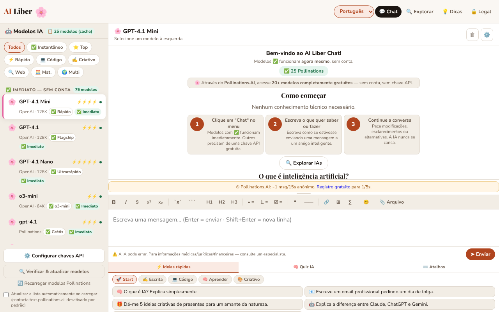

# AI Liber — A inteligência artificial para todos

[English](README.md) · [Română](README.ro.md) · [Français](README.fr.md) · [Italiano](README.it.md) · [Español](README.es.md) · **Português** · [Deutsch](README.de.md) · [Magyar](README.hu.md)

**Versão:** 1.3.0 · **Última atualização:** 2026-10-19

Converse com modelos de inteligência artificial gratuitos ou com as suas próprias chaves API, além de um guia das melhores IA gratuitas, num único ficheiro HTML.

**Aplicação online:** https://chiuta.github.io/AI-Liber/

## O que é

O AI Liber é uma aplicação de um único ficheiro (`index.html`) que oferece uma interface de chat única para vários fornecedores de modelos de linguagem: serviços gratuitos sem conta (por exemplo Pollinations, DuckDuckGo AI Chat, AI Horde), serviços com chave API própria (OpenAI, Anthropic, Gemini, Groq, Mistral, OpenRouter, Perplexity), servidores locais (Ollama, LM Studio) e um modelo executado diretamente no navegador através do WebLLM. Inclui também uma secção com um catálogo de IA gratuitas, um questionário e ideias de prompts.

## Funcionalidades

- Chat com seletor de modelo/fornecedor, envio com o botão «➤ Enviar», interrupção de um pedido em curso.
- Barra de formatação Markdown (negrito, itálico, rasurado, código, lista, citação, tabela, etc.).
- Painel «Configurar chaves API» para os fornecedores que exigem chave; as chaves são guardadas localmente, ofuscadas com AES-GCM (a aplicação avisa explicitamente de que não é uma cifragem robusta).
- Botão «Verificar e atualizar modelos» para atualizar a lista de modelos.
- Suporte para servidores locais Ollama (`localhost:11434`) e LM Studio (`localhost:1234`) e para um modelo local no navegador (WebLLM).
- Catálogo «As melhores IA gratuitas», filtrável por categorias (Chat, Investigação, Imagens, Vídeo IA, Média, Código, Escrita, Produtividade, Criativo) e por «Sem conta» / «Local (navegador)».
- Painel inferior com «⚡ Ideias rápidas» (prompts), «🧠 Questionário IA» e «⌨️ Atalhos».
- Interface em 7 idiomas: romeno, inglês, francês, alemão, espanhol, português, italiano.
- Textos de privacidade (RGPD), termos e informações sobre cookies/armazenamento local, em cada idioma.

## Novas funcionalidades (1.1.0)

- **Verificação local de dados pessoais antes do envio** (`FFF.pii`): quando a mensagem está prestes a seguir para um serviço externo (Pollinations, DuckDuckGo, AI Horde, API com chave), a aplicação procura localmente e-mails, telefones, IBAN (mod 97), CNP (dígito de controlo), cartões (Luhn), IP, chaves/tokens. Se encontrar algo, não envia nada até escolher: «Mascarar os assinalados e continuar», «Continuar sem mascarar» ou «Cancelar» (o texto permanece no campo). Pode ser desligada na barra lateral (a preferência é guardada). Para os modelos locais (WebLLM, Ollama, LM Studio) a caixa de diálogo não é apresentada, porque o texto não sai do computador.
- **Indicador «o que sai deste dispositivo»** junto ao seletor de modelo: «Local: as mensagens ficam no navegador» (WebLLM), «Local: as mensagens vão apenas para o servidor deste computador» (Ollama/LM Studio) ou «As mensagens seguem para <anfitrião>» (serviços externos). No WebLLM, o indicador esclarece que os ficheiros do modelo são descarregados da rede na primeira utilização, mas o seu texto não sai.
- **Histórico local de conversas, opcional (desligado por predefinição):** se assinalar «Guardar as conversas neste dispositivo», as conversas são guardadas no `localStorage` (chaves `ailib_conv`, `ailib_hist`), com os dados pessoais mascarados se quiser (botão «Procurar dados pessoais no histórico»). O painel «🗂 Histórico local» tem pesquisa local por significado (`FFF.search`: BM25, sinais diacríticos, formas próximas, excertos realçados), retoma de uma conversa no chat, eliminação por conversa, exportação para Markdown.
- **Cópia cifrada do histórico** através da etiqueta de transparência (Exportar cifrado, palavra-passe). As chaves API e o segredo de sessão **não** entram na cópia (verificado num teste).

### Limites
- A deteção de dados pessoais é heurística (nomes próprios e moradas têm baixa confiança). Não garante a ausência de dados sensíveis.
- O mascaramento aplica-se ao texto do campo de mensagem, não aos ficheiros já carregados no chat.
- O histórico tem um limite de tamanho; ao ser excedido, as conversas mais antigas são eliminadas (com uma mensagem).

**Kit FFF.** Do `fff-kit` (colado em `index.html`, sem rede) usam-se os módulos `core, label, bundle, pii, search`: etiqueta de transparência (prima a versão no rodapé), exportação/importação/eliminação `.fff.json` com cifragem opcional AES-GCM + PBKDF2, deteção local de dados pessoais e pesquisa local BM25. A política CSP **não foi alterada** em relação à versão anterior, exceto os hashes `sha256` dos scripts em linha (os novos estilos estão em `<style>`, coberto pelo `style-src 'unsafe-inline'` já existente; não foi acrescentado nenhum anfitrião novo). As traduções dos textos novos para fr/it/es/pt/hu/de são automáticas e **não foram verificadas por nativos**. A deteção de dados pessoais é heurística: pode falhar ou assinalar por engano; não substitui a sua própria verificação.

## Manual de utilização

1. Abra a aplicação e escolha o idioma no seletor de idioma (Română, English, Français, Deutsch, Español, Português, Italiano).
2. Escolha um modelo da lista. Os modelos marcados «Sem conta» não exigem chave.
3. Para um fornecedor com chave: prima «⚙️ Configurar chaves API», introduza a chave do fornecedor pretendido e feche a janela.
4. Escreva a mensagem no campo de texto e prima Enter ou «➤ Enviar». Shift+Enter insere uma nova linha.
5. Formatação: Ctrl+B (negrito), Ctrl+I (itálico), Ctrl+Z (anular); Esc fecha as janelas; ↑↓ navegam na lista de modelos.
6. Para os modelos locais: inicie o Ollama com `OLLAMA_ORIGINS=* ollama serve` ou o servidor do LM Studio na porta 1234, e depois escolha o modelo local.
7. Use «⚡ Ideias rápidas», «🧠 Questionário IA» ou a secção «As melhores IA gratuitas» para inspiração e descoberta de serviços.
8. Para eliminar os dados, use as opções descritas na janela de privacidade ou limpe os dados do sítio no navegador.

## Privacidade e rede

A aplicação **não funciona estritamente offline**: o chat só funciona contactando os serviços que escolher.

- **Persistência das chaves API:** as chaves são cifradas (AES-GCM) com um segredo aleatório guardado no `sessionStorage`; na prática sobrevivem ao recarregamento do mesmo separador, mas **não a um separador novo nem ao reinício do navegador** (o segredo perde-se, as chaves cifradas ficam ilegíveis no `localStorage`), pelo que têm de ser reintroduzidas. Verificado por um teste (recarregamento: a chave permanece; separador novo: vazio).
- **Armazenamento local (localStorage):** o idioma (`ailib_lang`), as chaves API ofuscadas (`aik_enc_*`, `aik_*`) com um sal (`ailib_ksalt`), uma lista local de modelos que devolveram erro 404 (`ailib_404`), uma preferência de interface (`ailib_sbw`), a opção de atualização automática da lista de modelos (`ailib_pollauto`, apenas se a assinalar). No `sessionStorage`: um segredo de sessão (`ailib_ssec`).
- **Ao carregar a página:** não é enviado nenhum pedido automático ao Pollinations. A lista em direto de modelos (`https://text.pollinations.ai/models`) só é pedida se premir «Recarregar os modelos do Pollinations» / «Verificar e atualizar modelos» ou se assinalar explicitamente, na barra lateral, «Atualizar automaticamente a lista ao iniciar» (opt-in, desligado por predefinição; a preferência é guardada em `ailib_pollauto`). Até lá, utiliza-se o catálogo local da página. Quando uma resposta contém fórmulas (`$…$`), o KaTeX é carregado de `cdn.jsdelivr.net` (versão fixa, com verificação de integridade SRI).
- **Anfitriões de terceiros contactados, apenas após uma ação sua (enviar uma mensagem, recarregar a lista, ativar o WebLLM):** `text.pollinations.ai`, `auth.pollinations.ai` (Pollinations); `duckduckgo.com` (DuckDuckGo AI Chat); `aihorde.net` (AI Horde); `api.openai.com`, `api.anthropic.com`, `generativelanguage.googleapis.com`, `api.perplexity.ai` e outras API de fornecedores, apenas se usar a respetiva chave; `esm.run` (carregamento do WebLLM `@mlc-ai/web-llm@0.2.84`, apenas quando ativa o modelo no navegador) e, consoante o modelo, a transferência dos pesos a partir dos anfitriões do WebLLM.
- As suas mensagens são enviadas ao fornecedor escolhido; aplicam-se as políticas deste. As chaves são enviadas apenas ao fornecedor a que pertencem.
- Os ficheiros carregados no chat são processados localmente no navegador (`vendor/mammoth.browser.min.js` para .docx, `vendor/pdfjs/` para PDF), mas o texto extraído chega ao fornecedor escolhido juntamente com a mensagem. Os catálogos contêm ligações externas (apenas navegação, ao clicar).
- **CSP:** o script em linha só é permitido por hash `sha256` (sem `'unsafe-inline'` em `script-src`); os eventos da interface são tratados por um despachante delegado (`data-onclick`, `data-onchange`, `data-oninput`, `data-onkeydown` + `data-arg`), sem atributos `on*` em linha. **Após qualquer alteração do script, recalcule o hash na meta CSP.** Os anfitriões permitidos em `script-src` (`esm.run`, `cdn.jsdelivr.net`) mantêm-se para o WebLLM e o KaTeX, carregados apenas por ação sua.
- Os servidores locais (`localhost`) só são contactados se os selecionar; a partir de páginas HTTPS o navegador pode bloquear as chamadas para `http://localhost` (conteúdo misto).

## Limitações

As respostas da IA podem estar erradas; a aplicação apresenta sob o campo de mensagem o aviso «AI can make mistakes. For medical/legal/financial info — consult a specialist» (no idioma da interface). As mensagens são tratadas pelos fornecedores escolhidos, de acordo com as suas políticas.

## Execução local / offline

Descarregue `index.html` e abra-o num navegador. A interface, o catálogo, o questionário e os guias funcionam sem internet; para qualquer resposta do chat precisa de ligação ao fornecedor escolhido (ou de um servidor local Ollama/LM Studio iniciado no seu computador).

## Licença

MIT — consulte o ficheiro LICENSE

## Auditoria

Auditoria: 2026-10-10 (ronda 2: 2026-10-11) — `fetchPollModels()` é agora opt-in (já não corre no arranque nem em `visibilitychange` sem o seu consentimento); a mensagem da interface sobre as chaves diz explicitamente que duram apenas a sessão do separador; KaTeX a partir de cdn.jsdelivr.net (index.html:~7063). A apresentação Markdown das respostas da IA está protegida contra XSS (testado com ``, `javascript:`, atributos injetados em href, fórmulas). Correções de contraste e foco.

## Autor

Alexio — Alexandru-Ionuț Chiuță, contacto: alexio@trom.tf. A aplicação é oferecida no espírito do movimento trade-free TROM (trom.tf); o apoio voluntário é opcional.

## Resumo

O AI Liber é um front-end de chat HTML de um único ficheiro para serviços de IA gratuitos sem conta, API com chave própria, servidores locais Ollama/LM Studio e um modelo WebLLM no navegador, além de um diretório de ferramentas de IA gratuitas, um questionário e ideias de prompts. Interface em 7 idiomas. As chaves são guardadas no localStorage (ofuscadas com AES-GCM, não uma cifragem robusta). O chat requer acesso à internet para o fornecedor escolhido. Licença MIT.

## Fontes verificadas em 11.10.2026
- DuckDuckGo AI Chat (duck.ai), modelos gratuitos sem conta: TechRadar, «Duck.ai by DuckDuckGo review», 13 de julho de 2026 (https://techradar.com/pro/duck-ai-review): Claude 4.5 Haiku, GPT-4o mini, GPT-5 mini, gpt-oss-120b, Llama 4 Scout, Mistral Small 3 24B. Os modelos fixados no código da aplicação para o DuckDuckGo (Claude 3 Haiku, Llama 3.1 70B, Mixtral 8x7B, o3-mini) podem ser retirados; os ID de API do DuckDuckGo não podem ser verificados sem rede e não foram alterados (a aplicação tem «Verificar e atualizar modelos» e a lista de modelos que dão 404).
- Pollinations (texto, sem chave, ~1 pedido/15 s em modo anónimo, chave gratuita opcional): https://free-llm.com/provider/pollinations-ai (página atualizada em outubro de 2026).
- Os textos jurídicos (versão «v1.0 · 12 de abril de 2026») não foram modificados nesta ronda; a sua data é decisão do autor e não foi alterada.

## Histórico / Registo de alterações
- **1.1.0 — 2026-10-14:** verificação local de dados pessoais antes do envio (`FFF.pii`), indicador «o que sai», histórico local opcional com pesquisa (`FFF.search`), cópia cifrada `.fff.json` (`FFF.bundle`), etiqueta de transparência; testes em `tests/fff-r8.test.mjs`.
- 1.0.0 — 2026-10-12: a versão e a data da última atualização são apresentadas na aplicação
- **11 de outubro de 2026 (ronda 7)** — no painel de chaves API a nota de segurança já não mostra literalmente `<strong>NOT</strong>` (as etiquetas HTML foram retiradas do texto nos 7 idiomas); o cabeçalho «🤖 Modelos IA» do painel lateral e os emblemas «N modelos (cache/live)» traduzem-se agora ao mudar de idioma; as etiquetas de especificações dos modelos («O mais rápido», «Raciocínio», «Programação», etc.) estão traduzidas para EN/FR/IT/ES/PT/DE; os guias dos fornecedores nas Definições aparecem em inglês (não em romeno) nos idiomas que não o RO; a CSP mantém o hash recalculado. Os textos jurídicos não foram modificados. 0 erros, axe 0 violações a 1280×800 e 360×740.
- **11 de outubro de 2026 (segunda intervenção)** — os 112 atributos `on*` em linha (85 tratadores distintos) foram substituídos por um despachante delegado ao nível de `body`, e a CSP já não tem `'unsafe-inline'` em `script-src` (hash `sha256`); a paridade de comportamento foi verificada automaticamente em 12 estados da aplicação (mais de 6.800 eventos disparados na versão antiga e na nova, as mesmas chamadas e argumentos, 0 diferenças) e com a CSP ativa (0 erros, 0 violações). O catálogo de modelos é agora reconstruído ao mudar de idioma (as etiquetas «corre no navegador», «Local no navegador», os grupos de raciocínio já não ficam no idioma anterior), os guias dos fornecedores nas Definições têm tradução em inglês (nos outros idiomas continuam em romeno), a etiqueta e as aria-label do widget de apoio estão traduzidas nos 7 idiomas, e as ofertas de créditos de teste nos guias da OpenAI/Anthropic são formuladas como variáveis («verifique no sítio»), e não como promessas.
- **11 de outubro de 2026** — o ecrã de boas-vindas é regenerado ao mudar de idioma (antes ficava em romeno numa interface inglesa/francesa, etc.); o banner já não enumera modelos perecíveis (GPT-4, Llama 70B, DeepSeek R1…); o guia do DuckDuckGo está datado e com aviso sobre modelos retirados; nota datada em «Explorar» sobre planos gratuitos variáveis; mensagem clara «está offline» (7 idiomas) em vez de um erro de rede quando escolhe um modelo que precisa de internet; a 360 px já não há transbordamentos horizontais (barra superior, página Legal).
- Acessibilidade: o conteúdo está em `main` (incluindo a página Legal), título `h1` oculto visualmente, ordem dos títulos corrigida, o widget de apoio tem o papel `complementary`; axe-core: 0 violações a 1280×800 e 360×740 nas páginas Chat, Explorar, Dicas e Legal. Os 113 atributos `onclick`/`onchange` em linha mantiveram-se (a CSP permite `'unsafe-inline'`; refatorá-los seria arriscado sem testes de regressão alargados). A aplicação não tem número de versão.
