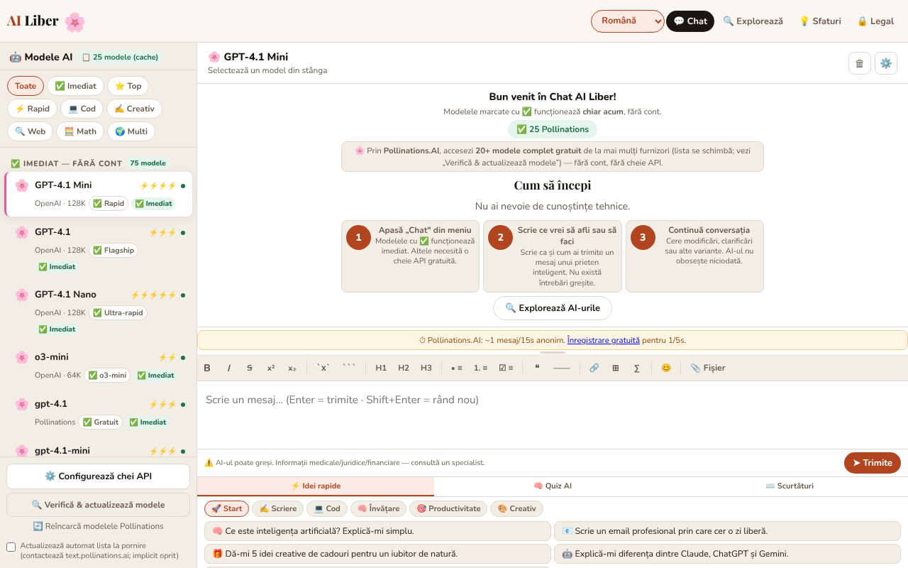

# AI Liber — Inteligența artificială pentru toți

[English](README.md) · **Română** · [Français](README.fr.md) · [Italiano](README.it.md) · [Español](README.es.md) · [Português](README.pt.md) · [Deutsch](README.de.md) · [Magyar](README.hu.md)

**Versiune:** 1.4.10 · **Ultima actualizare:** 2026-10-26

Limbile interfeței: **Română, English, Français, Italiano, Español, Português (PT), Deutsch, Magyar**

Chat cu modele de inteligență artificială gratuite sau cu cheile tale API, plus un ghid al celor mai bune AI-uri gratuite, într-un singur fișier HTML.

**Live:** https://chiuta.github.io/AI-Liber/

## Ce este

AI Liber este o aplicație single-file (`index.html`) care oferă o interfață unică de chat către mai mulți furnizori de modele de limbaj: servicii gratuite, fără cont (de exemplu Pollinations, DuckDuckGo AI Chat, AI Horde), servicii cu cheie API proprie (OpenAI, Anthropic, Gemini, Groq, Mistral, OpenRouter, Perplexity), servere locale (Ollama, LM Studio) și un model rulat direct în browser prin WebLLM. Include și o secțiune cu un catalog de AI-uri gratuite, un quiz și idei de prompturi.

## Funcții

- Chat cu selector de model/furnizor, trimitere cu butonul „➤ Trimite”, oprirea unei cereri în curs.
- Bară de formatare Markdown (aldin, cursiv, tăiat, cod, listă, citat, tabel etc.).
- Panou „Configurează chei API” pentru furnizorii care cer cheie; cheile sunt păstrate local, obscurizate cu AES-GCM (aplicația avertizează explicit că aceasta nu este criptare robustă).
- Buton „Verifică & actualizează modele” pentru reîmprospătarea listei de modele.
- Suport pentru servere locale Ollama (`localhost:11434`) și LM Studio (`localhost:1234`) și pentru un model local în browser (WebLLM).
- Catalog „Cele mai bune AI-uri gratuite”, filtrabil pe categorii (Chat, Cercetare, Imagini, Video AI, Media, Cod, Scriere, Productivitate, Creativ) și pe „Fără cont” / „Local (browser)”.
- Panou inferior cu „⚡ Idei rapide” (prompturi), „🧠 Quiz AI” și „⌨️ Shortcuts”.
- Interfață în 8 limbi: română, engleză, franceză, germană, spaniolă, portugheză, italiană, maghiară.
- Texte de confidențialitate (GDPR), termeni și informații despre cookie-uri/stocare locală, în fiecare limbă.

## Funcții de confidențialitate (din 1.1.0)

- **Verificare locală de date personale înainte de trimitere** (`FFF.pii`): când mesajul urmează să plece către un serviciu extern (Pollinations, DuckDuckGo, AI Horde, API-uri cu cheie), aplicația caută local e-mailuri, telefoane, IBAN (mod 97), CNP (cifră de control), carduri (Luhn), IP, chei/token-uri. Dacă găsește ceva, nu trimite nimic până alegi: „Maschează bifatele și continuă”, „Continuă fără mascare” sau „Anulează” (textul rămâne în câmp). Se poate opri din bara laterală (preferința se păstrează). Pentru modelele locale (WebLLM, Ollama, LM Studio) nu se afișează dialogul, fiindcă textul nu părăsește calculatorul.
- **Indicator „ce pleacă din acest dispozitiv”** lângă selectorul de model: „Local: mesajele rămân în browser” (WebLLM), „Local: mesajele merg doar la serverul de pe acest calculator” (Ollama/LM Studio) sau „Mesajele pleacă spre <gazdă>” (servicii externe). La WebLLM, indicatorul precizează că fișierele modelului se descarcă din rețea la prima folosire, dar textul tău nu pleacă.
- **Istoric local de conversații, opțional (oprit implicit):** dacă bifezi „Salvează conversațiile pe acest dispozitiv”, conversațiile se păstrează în `localStorage` (cheile `ai-liber.conv`, `ai-liber.hist`), cu datele personale mascate dacă vrei (buton „Caută date personale în istoric”). Panoul „🗂 Istoric local” are căutare locală după sens (`FFF.search`: BM25, diacritice, forme apropiate, fragmente evidențiate), reluarea unei conversații în chat, ștergere pe conversație, export Markdown.
- **Copie criptată a istoricului** prin eticheta de transparență (Exportă criptat, parolă). Cheile API și secretul de sesiune **nu** intră în copie (verificat în test).

### Limite
- Detecția de date personale este euristică (nume proprii și adrese au încredere scăzută). Nu garantează absența datelor sensibile.
- Mascarea se aplică textului din câmpul de mesaj, nu fișierelor deja încărcate în chat.
- Istoricul are plafon de dimensiune; la depășire se elimină cele mai vechi conversații (cu mesaj).

**Kit FFF.** Din `fff-kit` (lipit în `index.html`, fără rețea) se folosesc modulele `core, label, bundle, pii, search`: etichetă de transparență (apasă versiunea din subsol), export/import/ștergere `.fff.json` cu criptare opțională AES-GCM + PBKDF2, detecția locală de date personale și căutarea locală BM25. Politica CSP **nu a fost schimbată** față de versiunea anterioară în afară de hash-urile `sha256` ale scripturilor inline (stilurile noi sunt în `<style>`, acoperit de `style-src 'unsafe-inline'` deja prezent; nu s-a adăugat nicio gazdă nouă). Traducerile textelor noi în fr/it/es/pt/hu/de sunt automate și **neverificate nativ**. Detecția de date personale este euristică: poate rata sau semnala greșit; nu înlocuiește verificarea ta.

## Manual de utilizare

1. Deschide aplicația și alege limba din selectorul de limbă (Română, English, Français, Deutsch, Español, Português, Italiano, Magyar).
2. Alege un model din listă. Modelele marcate „Fără cont” nu cer cheie.
3. Pentru un furnizor cu cheie: apasă „⚙️ Configurează chei API”, introdu cheia pentru furnizorul dorit și închide fereastra.
4. Scrie mesajul în câmpul de text și apasă Enter sau „➤ Trimite”. Shift+Enter inserează un rând nou.
5. Formatare: Ctrl+B (aldin), Ctrl+I (cursiv), Ctrl+Z (anulare); Esc închide ferestrele; ↑↓ navighează lista de modele.
6. Pentru modele locale: pornește Ollama cu `OLLAMA_ORIGINS=* ollama serve` sau serverul LM Studio pe portul 1234, apoi alege modelul local.
7. Folosește „⚡ Idei rapide”, „🧠 Quiz AI” sau secțiunea „Cele mai bune AI-uri gratuite” pentru inspirație și descoperire de servicii.
8. Pentru a șterge datele, folosește opțiunile descrise în fereastra de confidențialitate sau golește datele site-ului din browser.

## Confidențialitate și rețea

Aplicația **nu este strict offline**: chatul funcționează doar prin contactarea serviciilor alese de tine.

- **Persistența cheilor API:** cheile se criptează (AES-GCM) cu un secret aleator păstrat în `sessionStorage`; în practică ele supraviețuiesc reîncărcării aceleiași file, dar **nu și unei file noi sau repornirii browserului** (secretul se pierde, cheile cifrate rămân nereadabile în `localStorage`), deci trebuie reintroduse. Verificat prin test (reîncărcare: cheia rămâne; filă nouă: gol).
- **Stocare locală (localStorage):** limba (`ai-liber.lang`), chei API obscurizate (`ai-liber.aik.enc_*`, `ai-liber.aik.*`) cu o sare (`ai-liber.ksalt`), o listă locală de modele care au dat eroare 404 (`ai-liber.404`), o preferință de interfață (`ai-liber.sbw`), opțiunea de actualizare automată a listei de modele (`ai-liber.pollauto`, doar dacă o bifezi). În `sessionStorage`: un secret de sesiune (`ailib_ssec`). Plus preferința pentru verificarea datelor personale (`ai-liber.piiguard`) și, doar dacă bifezi opțiunea, istoricul local (`ai-liber.hist`, `ai-liber.conv`).
- **La încărcarea paginii:** nu se trimite nicio cerere automată către Pollinations. Lista live de modele (`https://text.pollinations.ai/models`) se cere doar dacă apeși „Reîncarcă modelele Pollinations” / „Verifică & actualizează modele” sau bifezi explicit, în bara laterală, „Actualizează automat lista la pornire” (opt-in, implicit oprit; preferința se păstrează în `ai-liber.pollauto`). Până atunci se folosește catalogul local din pagină. Când un răspuns conține formule (`$…$`), KaTeX este încărcat din `vendor/` (aceeași origine, cu verificare de integritate SRI).
- **Gazde terțe contactate, doar după o acțiune a ta (trimiterea unui mesaj, reîncărcarea listei, activarea WebLLM):** `text.pollinations.ai`, `auth.pollinations.ai` (Pollinations); `duckduckgo.com` (DuckDuckGo AI Chat); `aihorde.net` (AI Horde); `api.openai.com`, `api.anthropic.com`, `generativelanguage.googleapis.com`, `api.perplexity.ai` și alte API-uri ale furnizorilor, doar dacă folosești cheia respectivă; `raw.githubusercontent.com/mlc-ai/binary-mlc-llm-libs/00fe7a40e57e5e8eb9fef87526a4bf28ad5846c0/` (biblioteca modelului `.wasm`, commit fixat, verificată de WebLLM prin SRI SHA-256; doar când activezi modelul în browser) și `huggingface.co/mlc-ai/` (+ `*.huggingface.co`, `*.hf.co`) pentru ponderi, care nu au hash fixat. WebLLM însuși (`@mlc-ai/web-llm@0.2.84`) este în `vendor/`, nu pe un CDN.
- Mesajele tale sunt trimise furnizorului ales; politicile lor se aplică. Cheile sunt trimise doar furnizorului căruia îi aparțin.
- Fișierele încărcate în chat sunt procesate local în browser (`vendor/mammoth.browser.min.js` pentru .docx, `vendor/pdfjs/` pentru PDF), dar textul extras ajunge la furnizorul ales odată cu mesajul. Cataloagele conțin linkuri externe (doar navigare, la click).
- **CSP:** scriptul inline este permis doar prin hash `sha256` (fără `'unsafe-inline'` la `script-src`); evenimentele UI sunt tratate de un dispecer delegat (`data-onclick`, `data-onchange`, `data-oninput`, `data-onkeydown` + `data-arg`), fără atribute `on*` inline. **După orice modificare a scriptului, recalculează hash-ul din meta CSP.** `script-src` permite doar `'self'` (plus hash-ul scriptului inline): WebLLM, KaTeX, pdf.js și mammoth se încarcă din `vendor/`; nicio gazdă de CDN nu este permisă. Vezi `NOTICE.md`.
- Serverele locale (`localhost`) sunt contactate doar dacă le selectezi; din pagini HTTPS browserul poate bloca apelurile către `http://localhost` (mixed content).

## Limitări

Răspunsurile AI pot fi greșite; aplicația afișează sub câmpul de mesaj avertismentul „AI can make mistakes. For medical/legal/financial info — consult a specialist” (în limba interfeței). Mesajele sunt prelucrate de furnizorii aleși, conform politicilor lor.

## Rulare locală / offline

Descarcă `index.html` și deschide-l în browser. Interfața, catalogul, quiz-ul și ghidurile funcționează fără internet; pentru orice răspuns de chat ai nevoie de conexiune la furnizorul ales (sau de un server local Ollama/LM Studio pornit pe calculatorul tău).

## Licență

MIT — vezi fișierul LICENSE

## Audit

Audit: 2026-10-10 (rundă 2: 2026-10-11) — `fetchPollModels()` este acum opt-in (nu mai rulează la pornire sau la `visibilitychange` fără acordul tău); mesajul din interfață despre chei spune explicit că ele durează doar cât sesiunea filei; KaTeX din cdn.jsdelivr.net (index.html:~7063). Randarea Markdown a răspunsurilor AI este protejată împotriva XSS (testat cu ``, `javascript:`, atribute injectate în href, formule). Corecturi de contrast și focus.

## Autor

Alexio — Alexandru-Ionuț Chiuță, contact: alexio@trom.tf. Aplicația este oferită în spiritul mișcării trade-free TROM (trom.tf); sprijinul voluntar este opțional.

## Rezumat

AI Liber este o interfață de chat într-un singur fișier HTML pentru servicii AI gratuite fără cont, API-uri cu cheia proprie, servere locale Ollama/LM Studio și un model WebLLM în browser, plus un director de instrumente AI gratuite, un test și idei de prompturi. 8 limbi de interfață. Cheile se păstrează în localStorage (ofuscate AES-GCM, nu criptare puternică). Chatul necesită acces la internet către furnizorul ales. Licență MIT.

## Surse verificate la 11.10.2026
- DuckDuckGo AI Chat (duck.ai), modele gratuite fără cont: TechRadar, „Duck.ai by DuckDuckGo review”, 13 iulie 2026 (https://techradar.com/pro/duck-ai-review): Claude 4.5 Haiku, GPT-4o mini, GPT-5 mini, gpt-oss-120b, Llama 4 Scout, Mistral Small 3 24B. Modelele hardcodate în aplicație pentru DuckDuckGo (Claude 3 Haiku, Llama 3.1 70B, Mixtral 8x7B, o3-mini) pot fi retrase; ID-urile API ale DuckDuckGo nu pot fi verificate fără rețea și nu au fost schimbate (aplicația are „Verifică & actualizează modele” și lista de modele care dau 404).
- Pollinations (text, fără cheie, ~1 cerere/15 s anonim, cheie gratuită opțională): https://free-llm.com/provider/pollinations-ai (pagină actualizată în octombrie 2026).
- Textele juridice (versiunea „v1.0 · 12 aprilie 2026”) nu au fost modificate în această rundă; data lor este decizia autorului și nu a fost schimbată.

## Istoric / Changelog

### 1.4.9 — 2026-10-23
- Cheile de stocare au acum prefixul aplicației (`ai-liber.*`); datele existente (limba, istoricul, cheile API criptate, sarea) se migrează automat la pornire, iar copiile vechi `.fff.json` se pot importa în continuare.
- fff-kit 1.2.0: stocare fără prefix remediată
- Sugestii rapide: categoria „Productivitate”, lipsă, a fost adăugată în franceză, germană, spaniolă, portugheză și italiană (paritate între limbi).

### 1.4.7 — 2026-10-22
- Încărcarea bibliotecilor nu mai are încredere într-un CDN: WebLLM 0.2.84 (și KaTeX 0.16.9) sunt în `vendor/` și se încarcă din aceeași origine; bibliotecile de model (`.wasm`) vin de la un commit fixat din `binary-mlc-llm-libs` și sunt verificate prin SRI SHA-256 (refuzate la nepotrivire). CSP-ul nu mai permite `esm.run`, `cdn.jsdelivr.net` și nici întreg `raw.githubusercontent.com`.
- ID-urile modelelor Gemma 2 corespund acum WebLLM 0.2.84 (`gemma-2-*-it-q4f16_1-MLC`). `NOTICE.md` nou. Dimensiune adăugată: ~6,4 MB.

- 1.4.6 — 2026-10-22: fff-kit 1.1.4: ținte tactile și text minim
- 1.4.5 — 2026-10-22: fff-kit 1.1.2: PBKDF2 600 000 iterații, protecție anti-clickjacking
- 1.4.4 — 2026-10-22: Dialog de acord înainte de primul mesaj către un serviciu extern fără cheie (Pollinations, DuckDuckGo, AI Horde); confirmarea eliminării modelelor folosește dialog propriu, nu window.confirm; text ≥ 12 px și casete de bifat mai mari pe mobil.

- 1.4.3 — 2026-10-22: **remediere**: numele AI Horde și ale modelelor locale (LM Studio, Ollama), precum și cardul AI Horde din grila de explorare, urmează acum limba aleasă.
- **1.4.2 (22 octombrie 2026):** Titlul paginii urmează acum limba interfeței; etichetele din lista de modele și catalogul Explore se reconstruiesc la pornire în limba salvată (rămâneau în română după reîncărcare); textul dialogului de verificare a modelelor este tradus.
- **1.4.1 — 2026-10-19:** verificarea datelor personale înainte de trimitere, indicatorul „ce pleacă” și istoricul local opțional descrise mai sus (introduse în 1.1.0) sunt prezente în versiunea curentă: fuseseră eliminate din greșeală într-o curățare anterioară și au fost reimplementate cu același comportament și teste noi (`tests/fff-r8.test.mjs`). Interfața (inclusiv descrierile modelelor) este disponibilă în 8 limbi, inclusiv maghiara.
- **1.1.0 — 2026-10-14:** verificare locală de date personale înainte de trimitere (`FFF.pii`), indicator „ce pleacă”, istoric local opțional căutabil (`FFF.search`), copie criptată `.fff.json` (`FFF.bundle`), etichetă de transparență; teste în `tests/fff-r8.test.mjs`.
- 1.0.0 — 2026-10-12: versiunea și data ultimei actualizări sunt afișate în aplicație
- **11 octombrie 2026 (runda 7)** — în panoul de chei API nota de securitate nu mai afișează literal `<strong>NOT</strong>` (etichetele HTML au fost scoase din textul în cele 7 limbi); antetul „🤖 Modele AI” din panoul lateral și insignele „N modele (cache/live)” se traduc acum la schimbarea limbii; etichetele de specificații ale modelelor („Cel mai rapid”, „Raționament”, „Programare” etc.) sunt traduse în EN/FR/IT/ES/PT/DE; ghidurile furnizorilor din Setări apar în engleză (nu în română) în limbile non-RO; CSP-ul păstrează hash-ul recalculat. Textele juridice nu au fost modificate. 0 erori, axe 0 violări la 1280×800 și 360×740.
- **11 octombrie 2026 (a doua intervenție)** — cele 112 atribute `on*` inline (85 de handlere distincte) au fost înlocuite cu un dispecer delegat la nivel de `body`, iar CSP nu mai are `'unsafe-inline'` la `script-src` (hash `sha256`); paritatea de comportament a fost verificată automat pe 12 stări ale aplicației (peste 6.800 de evenimente declanșate pe versiunea veche și pe cea nouă, aceleași apeluri și argumente, 0 diferențe) și cu CSP activ (0 erori, 0 încălcări). Catalogul de modele se reconstruiește acum la schimbarea limbii (etichetele „rulează în browser”, „Local în browser”, grupele de raționament nu mai rămân în limba veche), ghidurile furnizorilor din Setări au traducere în engleză (în celelalte limbi rămân în română), eticheta și aria-label-urile widgetului de sprijin sunt traduse în cele 7 limbi, iar ofertele de credite de probă din ghidurile OpenAI/Anthropic sunt formulate ca variabile („verifică pe site”), nu ca promisiuni.
- **11 octombrie 2026** — ecranul de bun venit se regenerează la schimbarea limbii (înainte rămânea în română într-o interfață engleză/franceză etc.); bannerul nu mai enumeră modele perisabile (GPT-4, Llama 70B, DeepSeek R1…); ghidul DuckDuckGo este datat și cu avertisment despre modele retrase; notă datată în „Explorează” despre planuri gratuite schimbătoare; mesaj clar „ești offline” (7 limbi) în loc de eroare de rețea când alegi un model care are nevoie de internet; pe 360 px nu mai apar depășiri orizontale (bara de sus, pagina Legal).
- Accesibilitate: conținutul este în `main` (inclusiv pagina Legal), titlu `h1` ascuns vizual, ordinea titlurilor corectată, widgetul de sprijin are rol `complementary`; axe-core: 0 violări la 1280×800 și 360×740 pe paginile Chat, Explorează, Sfaturi și Legal. Cele 113 atribute `onclick`/`onchange` inline au rămas (CSP-ul permite `'unsafe-inline'`; refactorizarea lor ar fi riscantă fără teste de regresie extinse). Aplicația nu are număr de versiune.
